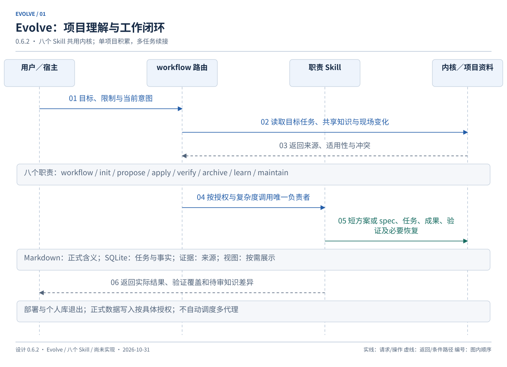

# Evolve 设计入口

设计基线 **0.6.2**；更新：2026-10-31。当前已按授权进入实现，实际能力和阶段证据见[实施记录](implementation.md)；未执行真实业务操作。工作约束先读 [AGENTS.md](../AGENTS.md)。

Evolve 帮助 AI 持续理解单个项目，减少重复补充背景，将开发和修复推进到实现与相关测试通过，并支持独立排查、数据开发、血缘梳理及多任务跨会话续接。项目可以被用户或其他工具自由修改，Evolve 负责核对与接纳变化。

## 日常流程

先恢复相关上下文，再按意图和复杂度推进：

- 未明确要求修改：调查 → 方案 → 等待修改确认。
- 已明确修改的简单任务：简短方案 → 实施 → 相关验证、代码审查和必要回归。
- 复杂任务：按需梳理 → spec 和任务清单 → 整体确认 → 按真实依赖逐项交付完整小流程 → 整体验收。
- 结束：保存结果和经验候选，集中展示正式知识修改，确认后生效。
- 若正式文档或规则本身是交付物，必须实际应用并验证；只有附带知识改进可延期。正常暂停保存部分进度，下次直接续接。
- 换会话：定位任务 → 核对现场变化和冲突 → 沿有效授权继续。

部署与个人跨项目经验库不在范围内。正式环境数据修改需针对环境、脚本、范围及恢复安排具体授权，未知结果先核实。



首选整包安装，项目启用与增量 init 分开；更新不隐式迁移项目数据。M1 为最小可试用版，M2 为日常工作可用版，M3 为完整首版。具体交付、依赖及验收见 [14 个实施切片](delivery.md#milestones)，安装和升级见 [生命周期约定](runtime.md#package-lifecycle)。以上为目标范围，已实现能力及安装证据以[实施记录](implementation.md)为准。

本仓库直接作为插件工程根，根 README 面向用户提供安装和快速上手；此文件继续负责设计导航。工程目录与用户／开发文档按 [工程交付表](delivery.md#engineering-delivery)随实施切片建立，按当前切片建立对应文件，实际状态见[实施记录](implementation.md)。

## 五份主文档

1. [总体设计](design.md)：目标、领域对象、数据权威、八个 Skill 和项目布局。
2. [工作流](workflows.md)：统一入口、授权、梳理、规划、实施、验证、封存及知识确认。
3. [运行契约](runtime.md)：上下文、版本、配置、SQLite、外部操作、多任务和恢复。
4. [实施与验收](delivery.md)：M0—M3、14 个完整小流程切片、V-001—V-140、新旧决定及修订追溯。
5. [场景演练](scenarios.md)：开发、排查、数据和多任务的预期交互；全部为模拟。

首次阅读 design → workflows → scenarios；后续按任务只展开相关契约。以下命令是设计中的逻辑形式；已开放方法、实际宿主入口和验证范围以根 README、用户指南及实施记录为准。

```text
/evolve analyze 排查订单汇总异常，先调查并给方案
/evolve propose 新增收藏功能，形成 spec 和任务清单
/evolve apply <明确目标>
/evolve verify <明确目标>
/evolve resume <任务标题>
```

`apply` 本身不隐含整体验收或知识批准。自然语言“按确认方案实现并测试通过”可以连续调用实施和验证；不要求用户手动发完各阶段命令。内部编号由系统维护。

## 文档、图册与历史

当前规则各有唯一负责文档；[图册清单](diagrams/manifest.json)列出 17 张现行 SVG，其中原发布图已替换为授权数据操作图。由 [图源](diagrams/diagram_sources.py)和[渲染工具](diagrams/render_diagrams.py)生成：

```text
python docs/diagrams/render_diagrams.py
python docs/check_design.py
```

这些命令仅绘图和校验文档，不执行插件。[一致性检查](check_design.py)覆盖本地引用、编号、命令归属、图源／渲染器／SVG 对应关系及快照。本轮 [0.6.2 修订记录](archive/revision-0.6.2.md)保存 Matt 对比采用、计划调整与文档检查；上一轮 [0.6.0 严格审核与 0.6.1 修订](archive/design-review-0.6.0.md)记录 12 项发现、修订和检查，原文在[审核前快照](archive/pre-review-0.6.0-20261031.zip)。[0.6.0 重构记录](archive/revision-0.6.0.md)及[早期重组记录](archive/consolidation-record.md)仅作历史。工程结构及安装／使用说明的本轮补充见[工程交付记录](archive/engineering-plan-0.6.2.md)。正式知识确认与成果封存分开，必需知识成果仍须实际交付。

