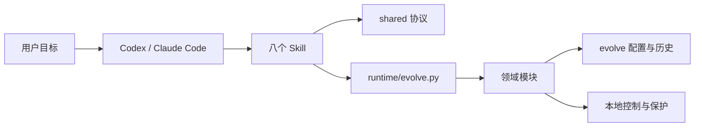

# 架构

Evolve 由八个 Skill、共享工作协议和一份 Python 内核组成。宿主负责理解用户请求、读取文件、准备方案与审查观察；内核负责项目身份、明确动作、持久化和执行保护。

## 入口与模块

| 部分 | 职责 |
|---|---|
| `skills/` | 按意图选择动作及所需协议，统一入口为 evolve-workflow |
| `shared/` | AI 准备请求和处理各分支时使用的执行约定 |
| `runtime/evolve.py` | 可从任意工作目录运行的 CLI 入口 |
| `evolve_core/package.py`、`cli.py` | 资源完整性、动作 owner、方法路由和当前请求绑定 |
| `plans.py`、`structured.py`、`revisions.py` | 方案、依赖任务和修订后的结果适用性 |
| `apply.py`、`checks.py`、`verify.py`、`archive.py` | 实施、检查、两维审查和完成截点 |
| `analysis.py`、`data_material.py`、`exporting.py` | 独立调查、数据上下文和保存底稿的导出 |
| `knowledge*.py`、`formal.py`、`patches.py`、`learning.py`、`rules.py` | 正式知识候选、应用、经验与规则 |
| `project_knowledge.py`、`knowledge_impact.py`、`knowledge_facts.py` | 分类知识、覆盖交付、主题替代、知识收尾与受限事实维护 |
| `store.py`、`workspace.py`、`protection.py` | 不可变事实、文件提交、占用和保护索引 |
| `continuation.py`、`resume.py`、`recover.py` | 正常续接、只读上下文和中断操作收尾 |
| `backup.py`、`archive_sets.py`、`maintenance.py` | 完整备份、恢复和显式升级 |
| `external*.py` | 固定材料、受控派发、未知结果核实和独立补偿 |

## 项目资料

`evolve/config.toml`保存身份与检查配置；`evolve/history.db`保存方案、版本、任务、运行、检查、正式知识和来源。大块内容以摘要引用的不可变 blob 保存，消费者分别记录来源与核查用途。

`.evolve-local/`保存文件 journal、占用、检查进程观察、保护索引、备份及导出。保护索引和日志负责恢复时不遗漏对象，正式内容及其适用性仍由已登记事实和实际文件决定。

工作资料放在目标项目，插件目录保存工具资源。用户或其他工具修改文件后，Evolve 核对实际字节并保留差异，不自动改回旧内容。

## 请求与阶段

AI 按[共享请求协议](../shared/protocol.md)提交带实际用户授权的输入；运行时定位当前工作项、方案和任务版本。新请求与精确原请求重试分别处理，相同请求身份不能绑定不同输入。

方案保存不代表接受；实施完成不代表整体验收；验收通过后仍需核对当前现场再封存。正常暂停保存部分结果，换会话沿适用的原来源启动新运行。纯状态、历史和上下文查询使用临时 SQLite 快照，保持现场与 sidecar 不变。

## 文件与执行保护

文件提交保存原值、候选和准确日志，写前检查摘要。中断后按原操作核实：仍为原值可继续，已是候选可补齐事实，第三种内容保留冲突。

短锁与事务只保护登记和提交，长命令在外部运行。检查进程组、未明执行身份和资源占用需要核实，不能仅凭主进程退出接管。最终检查和历史事实分别保存。

## 外部数据

受控同步 Python／SQLite 操作先固定入口、helper、SQL、别名、目标身份和前置，再呈现具体候选供批准。派发前保存执行保护，丢回执后保留未知，使用原操作只读核实。

补偿是独立的新任务、材料和具体授权。档案恢复合并必要的未决来源，保持实际业务数据不变。能力范围见[兼容说明](compatibility.md)，详细协议见[数据操作](../shared/external-work.md)。

## 完整包与升级

构建清单、两个宿主清单和内核版本必须匹配，每个资源按摘要核查。运行包的开发导航可在构建时移除，保留的本地链接仍须闭合。升级支持路径见[兼容说明](compatibility.md)，集合及恢复门禁由[维护协议](../shared/recovery.md)维护。
