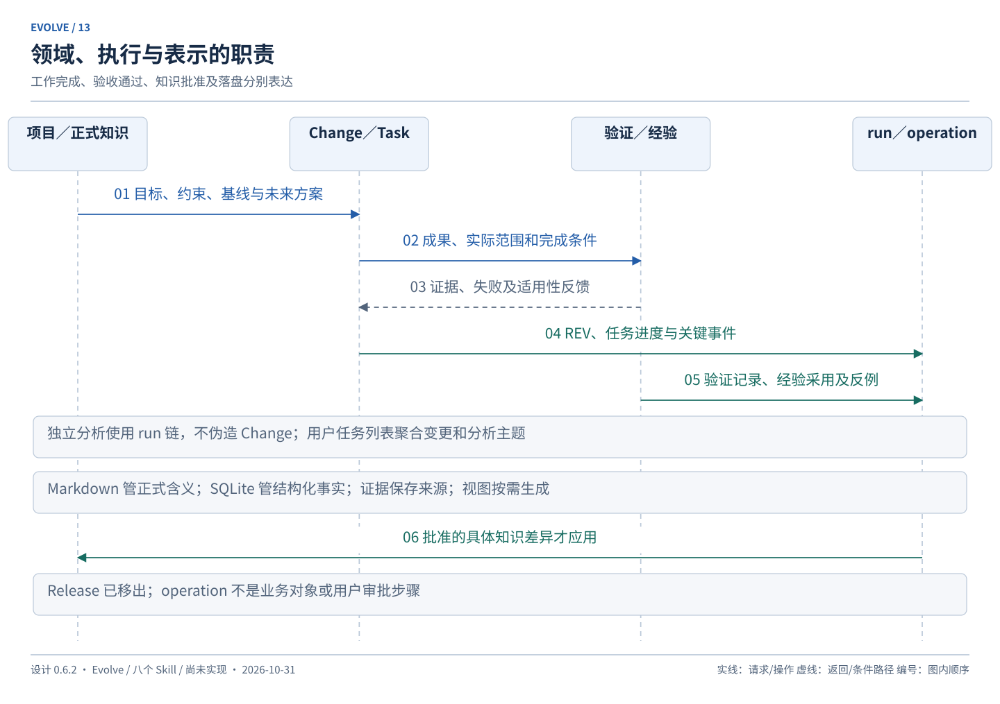
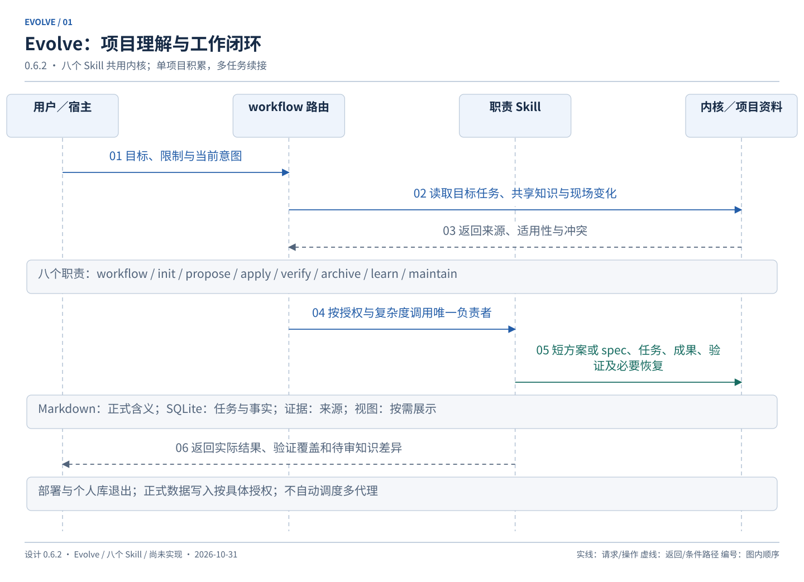

# 总体设计与领域模型

设计基线：**0.6.2**；更新：2026-10-31。本文定义目标、领域职责和数据权威。流程归 [workflows](workflows.md)，技术契约归 [runtime](runtime.md)，有效决定与验收归 [delivery](delivery.md)，例子归 [scenarios](scenarios.md)。

<a id="scope"></a>

## 目标与范围

Evolve 面向个人开发者与 AI，持续积累单个项目的业务背景、工作记录和经验，支持多个任务与会话并存。覆盖应用开发、SQL／模型调整、异常排查、血缘及项目知识整理；默认终点是约定成果完成、相关验收和必要回归通过。

产品名、逻辑入口和默认资料根为 Evolve、`/evolve <动作>`、`evolve/`。采用八个 Skill 与共享内核，优先验证 Codex 和 Claude Code。当前按计划实施，已开放能力与宿主验收见[实施记录](implementation.md)，不据设计宣称功能通过。

### 目标

- **G-001**：将需求澄清为目标、非目标、行为和可验证的完成条件，仅追问关键缺口。
- **G-002**：按项目和任务选择梳理深度，支持新项目及已有项目，尊重现有栈、目录和规范。
- **G-003**：建立需求、方案、任务、成果及验证之间的追溯；成果可为代码、SQL、模型、脚本或文档。
- **G-004**：保留动机、边界、方案版本、关键决定、失败尝试、实际结果和证据。
- **G-005**：不依赖旧聊天即可恢复任务；多个任务分别续接，并复用共享项目知识。
- **G-006**：按复杂度与影响选择材料和验证深度，简单工作无需完整规格文件。
- **G-007**：用短事务、版本校验及恢复减少遗漏、重复操作和虚假完成，不约束外部编辑方式。
- **G-008**：用户主要阅读方案、结果及待决差异，详细过程自动留档、按需展开。
- **G-009**：公共流程独立于宿主，发现、参数和权限差异由适配层处理并实测。
- **G-010**：独立调查保存事实、假设、来源和限制；没有修改授权时止于调查与方案。
- **G-011**：优先复用当前适用知识，减少同类任务重复补背景；以实际复用反馈衡量改善。
- **G-012**：正式知识由用户确认后生效；候选经验可供调查，不提升为强制规则。
- **G-013**：支持外部修改、多任务协调及最小依赖检查，不静默覆盖或串用上下文。

### 非目标

- **NG-001**：不建设 Web 后台、SaaS、多人实时协作或自动多代理调度平台。
- **NG-002**：不无差别保存全量源码、业务数据、聊天和每次工具调用。
- **NG-003**：不固定应用技术栈或数据平台，不建设数据资产、作业、血缘专用平台。
- **NG-004**：不复刻 OpenSpec／Matt 全部能力，不强制其 CLI、Issue 平台或命令别名。
- **NG-005**：不以文档、推断、候选经验或命令退出码替代真实验收。
- **NG-006**：不监控所有编辑器和操作系统活动；只能核对已读现场和已登记操作。
- **NG-007**：不自动提交、推送、合并或执行真实数据修改；具体修改授权按工作流核对。
- **NG-008**：当前不建设部署、发布对象、组合交付、部署回滚与环境发布管理。
- **NG-009**：当前不建设个人经验库、跨项目同步、跨项目晋升或模型参数训练。
- **NG-010**：首版不承诺跨分支 SQLite 自动合并、强制 worktree 或任意外部编辑器并发安全。

<a id="work-scope"></a>

## 工作范围和复杂度

梳理深度与实施复杂度是两个判断。轻量梳理读取局部足够资料；定向深入追踪相关业务链路；全局梳理建立整体结构和关键约束。已有资料可信时，复杂任务也不必重新全项目访谈；一个局部金额或 SQL 问题也可能先需要深查。选择与停止条件归 [上下文工作流](workflows.md#context)。

简单变更有可持久化的短方案，复杂变更使用 spec 和任务清单。复杂任务的 spec 是未来方案，不是已经生效的项目规格。业务日期、数据粒度、输入输出、口径、关系和覆盖范围仅在相关时记录，必要信息缺失不能因为模板“按需”而忽略。

工作范围区分用户要求的必需成果与过程中附带的知识改进。文档或规则本身就是交付物时，不能仅保存候选就报告完成；附带提案可以延期。实现、验证、正式知识应用各有依据，具体闭环见 [封存工作流](workflows.md#archive)。

正式环境数据修改是一类有外部副作用的实施操作，不是部署产品。它与普通成果形成共用 Change／Task／Verification，技术执行记录用 operation；范围、授权、未知结果和补偿见 [外部操作](runtime.md#external-effects)。不新增 Release 替代物。

<a id="domain"></a>

## 领域对象与职责边界

- **Project**：共享项目目标、边界、业务词汇、知识引用及迭代历史；身份不随目录、标题或会话变化。
- **Spec**：经确认的行为、口径、约束与验收含义。已批准且已实施的部分可以成为当前正式基线；未批准、未实现或与现场冲突的部分明确标注，不无条件称为当前事实。
- **Change／REV**：有范围、方案、验收和结果的一次修改；REV 绑定方案、任务定义、验收及具体接受依据。知识纠正也可使用文档类型 Change，不伪造代码工作。
- **Task**：Change 内的可验证实施单元，保存依赖和完成条件；用户口语中的“任务”还可能指整个 Change 或分析主题，界面需区分层次。
- Task 的负责动作默认 apply；纯正式知识成果由 init／sync／learn 的对应 owner 应用，不为统一形式迫使 apply 越权写正式知识。仍用同一 Task 模型，不新增文档平台。
- **Verification／Evidence**：验证说明具体成果、范围、方法与结果；证据说明观察者、来源、时点、内容和限制。分析证据可以没有 Verification。
- 验证明示受检对象是候选还是实际成果；候选内容检查不能冒充已经应用。封存保留验证截点，后续现场变化由当前适用性核查表达。
- **Experience**：有条件、来源、支持与反例的建议；确认程度不等于正式规则权威。
- **Rule**：用户确认的项目约束。经验再多次引用也不会自动成为 Rule。

Project 拥有正式知识与多个 Change；Change 经 REV 定义 Task；Task 产出成果，由 Verification／Evidence 核查。Experience 引用真实工作并记录后续采用效果，Rule 引用批准的修订及其来由。

独立分析继续用项目级 analyze run 顺序链表示，不为留档虚构 Change 或新增分析领域表。任务列表聚合 Change 与分析链，标题和宿主会话 ID 只是检索辅助，不是身份。单分析链顺序续查，不同主题可同时存在。

**执行层**中，run 表示一次职责执行，operation 表示需幂等／恢复的操作，event 记录关键事实；它们不等同于工作成果、验收或用户授权。**表示层**包括 Markdown、SQLite、附件和生成视图，不为同一事实维护第二个编辑权威。

事实确定性为 confirmed／inferred／risk／unknown，必须附来源和适用范围。“已确认源码存在某表达式”不证明生产按该表达式运行，也不证明用户希望保留该行为。



<a id="authority"></a>

## 数据权威与正式知识

### Markdown

现有项目文档可映射沿用，不强制搬迁。Markdown 保存正式目标、词汇、规格／AC 含义、长期决定和规则；复杂任务 spec／方案为候选材料。简单方案正文可直接作为不可变文本 artifact 快照保存，不要求额外 proposal.md。

正式知识初次创建或修改均有具体候选差异、来源和确认记录；受理工作请求不等于批准尚未呈现的正式知识内容。已呈现且明确批准的具体差异，在版本与范围仍有效时不用再批一次。同步时仍核对实现／验证适用性。审批流程由 [workflows](workflows.md#knowledge-approval)唯一维护。

### SQLite

保存项目／Change 身份、REV、完整 Task 定义与状态、方案呈现与接受、验证、经验、分析、关键事件及来源关联。保存正式知识的索引、候选差异、批准依据与已应用记录，不复制一套可独立修改的正式正文。

上下文观察、失败尝试、执行进度和候选经验可自动留档；它们是证据或线索，不自动提升为正式业务约定。新事实与旧规格冲突时，同时展示“现场观察”和“现行约定”，不把冲突藏在摘要里。

### 证据、视图和外部文件

必要附件保存真实来源和摘要。tasks.md、verification.md、resume.md、analysis.md、图及经验摘要是按需生成的视图；直接编辑不反向改变实际完成或批准记录。用户编辑的视图可被发现并作为待核对输入，不自动删除或默认为执行事实。

代码、SQL、业务配置与真实数据代表现场；未登记修改先作为观察接纳，不回退用户文件，也不补造实施者、意图或通过证据。用户直接改正式文档时保留实际内容，登记“外部修改／确认来源未核实”，相关正式含义冲突需核对，不能悄悄用旧快照覆盖。

工具配置归 init；其写入能力和语义摘要归 runtime。生成视图、索引或运行状态不应重复表达同一可编辑业务字段。

<a id="architecture"></a>

## 八个 Skill 与共享内核

- **evolve-workflow**：入口规范化、只读路由、任务定位、状态、下一步与上下文恢复；调用相应 owner，不代写业务。
- **evolve-init**：接入记录设施、发现与导航、提出基线候选、维护工具配置。新业务骨架属于普通规划／实施，不在 init 特设一条实现例外。
- **evolve-propose**：调查 analyze、创建／修订短方案或 spec、任务拆分及正式业务知识修订候选。
- **evolve-apply**：按有效方案和授权实施；正式环境数据写入及结果核实也由它负责。
- **evolve-verify**：相关检查、必要回归和证据采纳；不静默修改业务实现。
- 代码审查由 verify 按影响组织，规格符合性与项目规范／维护性分别给结论；发现转 apply 修复，仍遵守现有授权。排错判据复用分析和验证，不新增 reviewer 或 debugger 领域对象。
- **evolve-archive**：封存完成事实；sync 应用已批准且适用的业务规格／项目知识差异，不自动批准。
- **evolve-learn**：项目内经验记录、检索、反馈、反例与规则提案；确认后应用规则，不代改业务规格。
- **evolve-maintain**：查询、导出、取消、备份、恢复与受管一致性维护；只补确定性事实。

共享内核统一配置、版本、事务、幂等、引用、证据、操作与恢复。业务 owner 判断含义，内核执行确定性校验；owner_skill 仅用于归属，不是认证身份。跨阶段通过 run.result 与后继 input_checks 关联，不恢复旧独立交接／回执模型。

Skill 数量不等于用户步骤数。自然语言完整请求可在已授权范围连续调用；独立阶段命令保持边界。公共规则只维护一份，宿主包装只负责发现、资源定位、参数和权限适配。



<a id="layout"></a>

## 预期布局与支持范围

当前仓库直接作为插件工程根；原示意名称 evolve-plugin 不要求再建一层子目录。参考 Matt 的工程组织与文档导航，保留 Evolve 的共享内核。以下区分插件工程与目标项目资料；工程文件按切片建立，目标项目目录按实际需要生成，已实现范围及证据见[实施记录](implementation.md)。

```text
<当前仓库根>/
  README.md                   # 产品入口、安装、快速上手与能力导航
  LICENSE                     # 采用的许可证及必要来源声明
  CHANGELOG.md                # 插件发行版本与用户可感知变化
  CONTRIBUTING.md             # 贡献入口，链接开发说明
  AGENTS.md                   # 维护插件工程的规范入口
  NOTICE.md                   # 来源与采用边界
  .codex-plugin/plugin.json   # Codex 整包插件清单
  .claude-plugin/             # Claude 插件清单与本地市场
  .agents/plugins/marketplace.json # Codex 本地市场
  evolve-package.json        # 运行包文件清单、版本和内容摘要
  skills/evolve-*/SKILL.md     # 八个职责
  shared/                     # 公共契约与渐进加载资料
  runtime/evolve.py           # 确定性工具入口
  runtime/evolve_core/
  assets/templates/
  tests/                      # 行为、集成及故障恢复验证
  scripts/                    # 按需增加检查、打包等开发工具
  docs/
    README.md                 # 设计与维护导航
    installation.md           # 分宿主安装、更新、卸载
    usage.md                  # 完整任务案例与动作速查
    troubleshooting.md        # 诊断、常见问题与恢复限制
    development.md            # 本地开发、测试和打包
    <现有五份主文档、diagrams/、archive/>

target-project/
  <既有源码、SQL、文档及宿主规则>
  evolve/
    config.toml
    history.db
    project.md                 # 正式基线，经确认生效；可映射已有文档
    specs/
    decisions/
    changes/                   # 标准 spec 或按需导出
    evidence/
    exports/                   # 可再生成视图
  .evolve-local/               # 控制清单、短锁、暂存与本地备份
```

插件工程与 target-project 中的工作资料是两套内容；后者由用户在目标项目接入后生成，不混入插件源码或发行包。工程文档、目录建立时点及验收归 [实施计划](delivery.md#engineering-delivery)。IMP-001 已将工程规范正文整理到 AGENTS.md，AGENT.md 保留兼容指针；后续维护一份权威正文并核对引用。

布局是按需能力清单，不是 init 必须创建全部空目录。无 personal 库或 releases 目录。历史数据库随 Git 保存，禁止自动二进制合并；具体分支处置见 [Git 边界](runtime.md#database)。

默认以一个整包分发八个 Skill、shared、runtime 和模板；安装与项目增量 init 分开，安装成功不表示项目已接入或获准修改。宿主缓存位置与项目启用范围分开说明。M1 就验证实际安装、共享资源定位和升级隔离；不等待业务全做完再打包。生命周期约定由 [安装与升级契约](runtime.md#package-lifecycle)唯一维护。

已有术语表、ADR 和规范优先映射；没有资料时按实际内容渐进创建。术语表仅表达业务词义与边界，不混入运行日志或实施清单。重要决定只有涉及真实取舍、未来读者需要解释且反悔成本较高时才形成独立 ADR，普通选择沿既有方案记录。正式内容仍须具体确认，不新增强制文档模板或领域表。

首版支持同一项目目录中多个 Change／分析主题和会话并存。相关写入协调不等于长时间占有全项目；无关任务可推进。相同 Change 的修改串行受控；跨任务写入重叠需核对，独立调查可以并行。档案全局恢复时暂缓工具写入，不限制用户使用项目。

<a id="references"></a>

## 参考与采用边界

2026-10-31 的 Matt 对比固定到 [a496f55](https://github.com/mattpocock/skills/tree/a496f5513d4a4cf889bc48e189e579f4b0bdf6aa)，不把可变 main 当永久依据。除 to-spec／to-tickets／implement 外，纳入 implement-spec、code-review、diagnosing-bugs、domain-modeling、retro 及安装说明，具体来源与采用处置见 [0.6.2 修订记录](archive/revision-0.6.2.md)。采用完整小流程、真实阻塞依赖、行为测试接口、双维审查、可重复症状判据及整包安装思想；大范围迁移允许兼容扩展、分批迁移、清理与最终集成验收。

Evolve 按本项目决定采用项目内任务记录、按影响验证和明确授权；不照搬外部平台写入、自动提交或固定全量测试。以上是参考资料，不是本项目实现依赖，也不是自动执行外部 Skill 的指令。

Matt 已支持本地任务文件和术语／决定／复盘积累；Evolve 不将这些描述为独有优势。implement-spec 的多代理、独立 worktree、集成分支与合并流程不纳入当前默认范围。Evolve 的区别在已设计的授权、持久事实、经验反馈和恢复闭环；当前仍未实现，不能宣称实测优于上游。

OpenSpec 的当前规格、独立变更和可追溯修订思想继续作为设计背景；旧参考和版本依据在 [0.5.6 快照](archive/pre-revision-0.5.6-20261031.zip)。本次不重新声明上游完整兼容。

