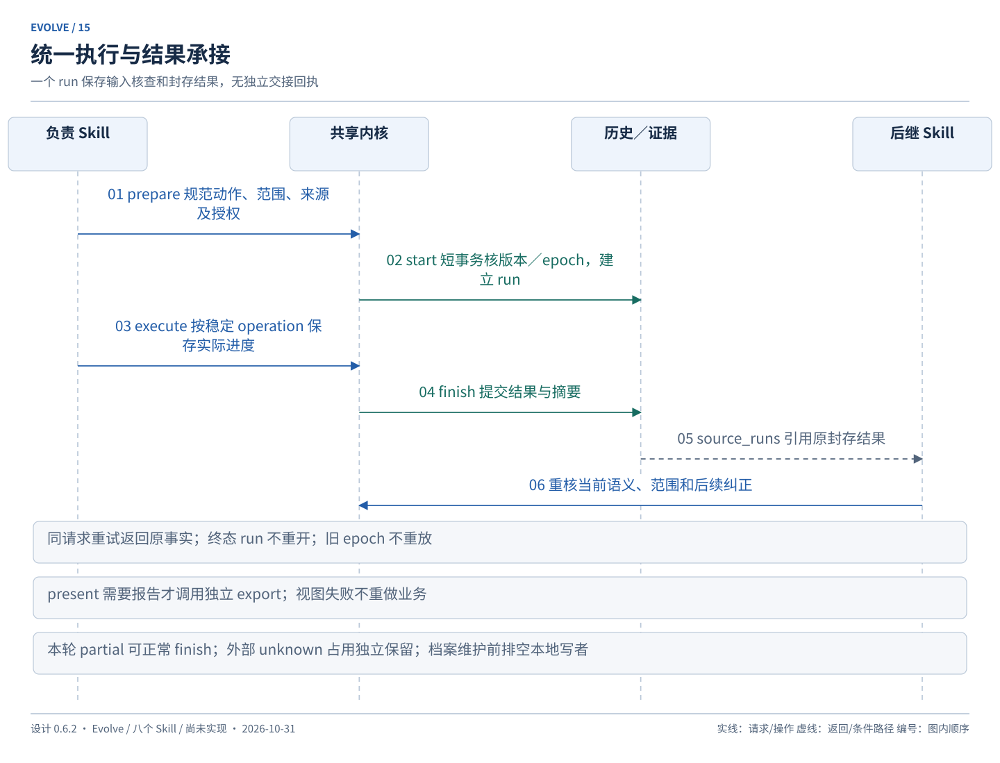
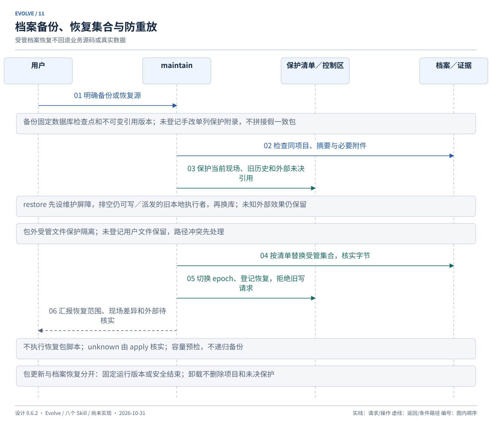

# 运行契约、存储与恢复

设计基线：**0.6.2**；更新：2026-10-31。本文是技术字段、持久化、并发协调、外部操作及恢复的权威。动作许可由 [工作流](workflows.md)定义，不由字段存在或配置可用推导授权。

<a id="environment"></a>

## 运行环境与适配

工程基线为 Python 3.11+ 标准库、sqlite3、TOML 配置和 UTF-8 Markdown。实现时探测实际模块和可用版本，当前实际开放范围与验收见[实施记录](implementation.md)。普通事务采用显式控制，不依赖 Python 版本的默认提交行为。

插件只读安装根与目标项目根分开定位，公共资源只分发一份。宿主适配仅处理发现、参数、权限与资源定位；业务逻辑不依赖宿主专属钩子或后台代理。整包格式和 schema 同步校验，未知更高版本只读诊断，不无记录降级执行。

<a id="package-lifecycle"></a>

### 整包安装与生命周期

首选宿主支持的完整插件包：八个 Skill、shared、Python runtime、模板及所需宿主清单作为同一版本交付，不为每个 Skill 复制一套内核。维护一份来源与发布内容，宿主清单可分别适配。分发记录至少说明 package_version、内容摘要、支持的 Python／宿主与内核协议版本、可读／可写 schema 范围；版本相同但内容不匹配也不能混用。设计基线（当前 0.6.2）、插件发行版本、内核协议与 schema 版本分别标识；设计修订不冒充插件发行。包清单与运行时元数据使用同一插件发行版本，CHANGELOG 对应实际能力和兼容变化，验收证据绑定受检包内容摘要。元数据与打包检查随 IMP-001 实现，真实通过状态见[实施记录](implementation.md)。

发行内容包括八 Skill、单份 shared／runtime、所需模板、宿主清单、许可证／必要来源声明，以及 Skill／runtime 运行时引用的全部资料；打包前检查引用闭合。用户安装／使用／诊断说明随包提供，或提供对应固定发行版本的可达入口；执行时必须能离线读取的指令与资料仍放包内。设计档案、测试、绘图与开发工具留在源码仓库，非运行必需时不进入运行包；目标项目配置、history.db、证据、控制区、凭证和缓存不进入发行包。具体开发／打包检查与文档交付时点归 [实施计划](delivery.md#engineering-delivery)。

安装、项目启用、项目接入分别处理：宿主安装器负责包的获取／更新／禁用／卸载及其宿主配置，init 仅在明确接入后维护目标项目的 Evolve 配置／记录设施，maintain doctor 只读报告安装完整性与项目兼容性。安装器的流程不成为第十五个 Evolve 动作，init 不自我升级，doctor 不偷偷下载、建库、修复配置或迁移。缺 Python 或关键资源时给明确诊断与安装建议，不自动装系统依赖。

默认项目范围启用；宿主把包保存在用户缓存并不等于所有项目都获准启用。分别说明实际安装位置、启用配置范围和项目数据位置；若目标宿主不能兑现项目范围，先报告限制，不用一次全局安装冒充项目级能力。逻辑 `/evolve` 与宿主实际调用名分别记录，不承诺未验证的命令别名。

每个宿主只选择一个安装渠道，识别插件版与散装 Skill 的重复发现和版本冲突，发现冲突时报告来源并阻止含糊的写调用，不自动删除用户安装。包内资源从所加载的实际包根解析，不依赖当前工作目录、原始源码仓库、下载暂存目录或固定用户路径。包内资源须位于包中；项目映射则按项目路径约定核查。在当前实际执行环境中，空格／中文路径、缓存移动及移除原始下载副本后仍需验证资源可用；不设置额外平台验收前置。

普通按 Skill 复制的安装方式不作为 M1 的完整安装渠道：现有 shared／runtime 是兄弟目录，不能假定选中八个 Skill 就会复制整包。以后若提供兼容渠道，必须证明资源齐全、唯一内核、版本一致和升级行为；不得靠指向临时克隆的链接或八份内核副本绕过。整包本身不强制 MCP、Node 服务或新后台，是否公开发布不影响本地／私有安装验收。

### 更新、续接与兼容

包更新与项目数据变更分开。宿主可下载新包，但更新不得自动执行项目迁移、批准知识、改业务文件或重放旧请求。每次 run 记录包版本／摘要、内核协议与实际 schema；副作用前检查仍在同一可用包版本和兼容范围。当前执行固定使用完整旧版本或在安全点停止，新版本从后继 run 生效；不能让旧 Skill 指令和新内核继续组成同一个写流程。仅 Python 导入缓存不构成版本固定证明。

不能保证旧缓存保留、资源不被替换或旧执行者安全退出的宿主，只支持明确停止相关执行后切换版本；缺失／混合版本拒绝写入。正常结束可保存部分结果，异常中断沿已有 journal／recover；升级不清除未知外部操作或旧执行占用。兼容更新后重读现场和原授权，仍有效的范围可续用，不因升级重复确认相同内容，也不借升级扩大授权。

首个可用切片从 schema v1 起步，不预建通用迁移平台。不兼容版本拒绝写入；只有兼容范围明确允许时才读取，否则仅提供文件级诊断。需要 schema 迁移时另给具体差异、影响、保护与回退方案，获明确授权后由 maintain 复用受管维护协议处理，不能让 init 假装首次接入。不把二进制安装当作迁移授权，也不承诺尚未设计实现的迁移方法已可用。回退包仅在旧包兼容当前 schema／协议时可用，降级代码不回退数据库或真实数据。

M1／M2 的真实试用档案是长期项目资料。后续切片若改变持久结构且需要接续这些资料，必须将最小定向迁移、所需方法及保护／恢复验收纳入该切片的具体实现方案，经确认后才能宣称可原地升级；不必因此提前建设任意版本通用迁移器。未提供所需迁移时，阻止新包对旧库写入并说明保留旧兼容包的路径，不静默清库、重建身份或把用户数据当一次性夹具。一次性验收夹具与实际试用数据必须区分。

禁用／卸载由宿主管理器执行，只移除选定包及必要宿主登记，不删除目标项目的 evolve/、.evolve-local/、映射文档、证据、历史、备份或未决外部保护。存在本地在途写入时先停止／安全收尾；卸载不证明已派发外部操作停止。项目数据清理是独立明确请求。重新安装复用原身份并检查兼容性，不创建第二个项目库或重置授权／未决状态。

M1 必须在两个宿主实际安装包后验收；读取本地仓库文件或只见到 Skill 名称不算安装通过。安装／更新／卸载记录由宿主管理器或验收证据承接，不为没有接入的项目偷偷建 run 或数据库。

<a id="configuration"></a>

## 项目定位与配置

固定定位为项目根下 evolve/config.toml、evolve/history.db、.evolve-local/control/。project.id 创建后不可普通重配；history.backend 固定 sqlite，库和控制区路径固定。目录改名不改项目身份。

发现多个根、嵌套项目或同名非 Evolve 资料先定位；已有库而配置缺失不是新项目，不能自动重建。查询以禁止创建的只读方式打开已有库，配置异常时说明可信读取边界。项目内路径规范化并检查绝对路径、.. 和符号链接逃逸；不扫描其他项目拼接背景。

最小示例，仅表达格式，不将示例身份或命令照抄到项目：

```toml
config_version = 1
[project]
id = "replace-with-generated-project-uuid"
name = "example"
language = "zh-CN"
[history]
backend = "sqlite"
database = "evolve/history.db"
[paths]
local = ".evolve-local"
[context]
default = "adaptive"
[verification]
policy = "impact"
```

检查命令只在发现真实入口并核对副作用后配置为 argv 数组、cwd、timeout、适用范围和环境身份；不使用未经解释的拼接 shell 字符串。凭证来自现有环境或项目机制，值不入配置、数据库、日志或报告。正式环境数据执行依据具体批准候选，不设置部署配置。

### 受控维护与摘要

init 唯一维护工具配置；独立配置调整用独立 run，回原阶段重新 prepare。查询、分析、核实外部操作不会隐含重配。已授权明确调整可以在整体请求中调用 init，但保留独立结果，不改父请求输入。

首版写入子集为明确支持的表和标量／数组字段；采用定位替换或追加、保留未改字节、完整 TOML 解析及往返校验。未知关键字段、重复键、歧义格式或无法无损定位时原样保留并报告不支持，不整文件模板覆盖。类型／结构改变先呈现具体配置差异。

原始字节摘要保存审计；语义摘要按固定字段组计算：identity／paths、checks、context／display。checks、执行范围与相关依赖变化重核对应检查；展示语言和注释不使所有业务验证过期。无法证明配置影响范围时保守重核，并说明原因。身份／路径异常阻止写入，不作为普通复验处理。

手改配置可在后续明确写阶段调用 init 校验、登记可核实字段；查询只报告差异。未知命令或权限变化不能由“接纳外部修改”推定可执行。配置调整不重置已接受方案或已完成任务，业务含义变化仍走 REV。

配置与数据库提交使用 [文件操作协议](#recovery)，保存原字节和候选；文件已为候选时只补登记，第三种值保留冲突。不运行配置中的命令来“完成恢复”。

<a id="documents"></a>

## 材料、上下文与生成视图

最小工作材料包含目标／问题、对象和范围、来源、方案或调查路径、完成条件、限制。日期、粒度、技术版本、比较基准和数据覆盖按任务需要提供，缺关键字段标未知或澄清。已有资料可引用，不强制复制全部正文。

简单方案在对话呈现后按实际文本保存为 artifact／blob，并绑定 REV、呈现时间及授权；独立 Markdown 文件按需生成。复杂方案保存 spec／必要设计文档，任务定义归数据库，tasks.md 为视图。首次项目知识仅为候选，批准后才能以正式基线登记。

每个可用上下文条目的索引或引用至少有：

- 类型与稳定 artifact／实体／局部发现引用；
- 范围（项目、模块、对象、日期或版本等适用字段）；
- 来源／观察者、观察时间和记录时间；
- 确定性、确认依据和实际内容摘要；
- 后续纠正／替代／争议信息。

这些值复用 artifact_versions、spec_items、经验和分析记录；不另建全量项目知识库或双写正文。当前上下文包由查询生成，不是新的可编辑状态。加载顺序为适用正式规则／项目约定、相关方案与现场、历史事实、经验线索；来源冲突显式呈现。尚未核对时使用 unconfirmed，不把“查不到变化”当有效证明。

检索结果同时说明 searched_scope、source_status 和限制；source_status 区分可用、未覆盖、索引失配、来源不可访问，空结果不表示“没有规则／经验”。索引仅导航：缺失或版本不符时可只读读取映射原文、已知 artifact 及相关封存结果，禁止查询借机重建索引。没有足够必需依据时只阻碍依赖它的结论或修改；可选经验不可用不一概阻断工作，结果注明未获得该帮助。

上下文检索按相关性覆盖归档任务的实际验证结果、尚未应用提案、延期／拒绝决定及后续反例，而不是只检索 active Change。已经核实的现场事实可减少重复询问；正式约定冲突仍需按用途处理，不让未批准提案成为约束。只生成少量带来源的读取清单，不持久化另一套“当前上下文正文”。

图文底稿保存已观察的关系、端点、转换、来源和覆盖；图与报告从封存结果生成。exports、tasks、resume、verification、analysis 等视图标注源版本、生成时间及观察截止点。重导不补事实，缺底稿如实报告；导出不得覆盖源资料。

<a id="tools"></a>

## 工具接口与幂等

唯一工具入口的动作与 [工作流映射](workflows.md#commands)一致。工具接受规范动作、目标及当前授权范围，不重新猜测同一请求的语义。用户不填写内部 ID。

写请求包含 project_id、request_id、owner_skill、action／method、targets、input／digest、expected_workspace_epoch、expected_versions、授权引用；start 后增加 run_id，子操作有稳定 operation_id。目标和引用必须带 entity_type／entity_id／版本，不把关键范围藏入任意 JSON。附加非门禁信息才可用 details。

请求键为 project_id＋workspace_epoch＋request_id；操作 ID 同项目唯一。同 ID 相同规范输入返回已有事实，不创建第二次动作；同 ID 不同输入拒绝。当前 epoch 下先查已提交幂等结果，再核首次写入的 expected_versions；旧 epoch 请求拒绝，不以换 ID 绕过未知外部操作。未完成操作返回待恢复状态。

固定响应包含 ok、action、operation_id、data、warnings，错误有 code／message／next_steps。data 包含 committed、run_id、实体版本、业务 outcome、证据和视图／备份状态。ok 只表示接口操作是否成功，不能代替验收结果。

退出码：0 为成功登记／查询，2 为输入或前置错误，3 为版本／占用冲突，4 为待恢复，5 为外部失败或未知，1 为内部错误。即使已经保存失败事实，也不能以成功业务结果隐藏 unknown。提交后视图或后置备份失败不重跑业务。

纯查询不建 run、不分配编号、不更新 guard／索引、不备份迁移。明确保存报告属于 export 写动作。首次 init 尚无库时使用独立控制清单；不伪造已有 epoch。

<a id="execution"></a>

## 执行生命周期与授权记录

prepare → start → execute → finish → present 由共享内核支撑：

1. prepare 只读规范化动作、目标、来源、当前意图、相关占用及恢复阻碍；查询至此返回。
2. start 以短事务复核版本和 epoch，保存不可变输入、source_runs 与 input_checks，幂等建立 run。 已登记消费者的实际来源核查在所属短事务中保存用途、目标／预期摘要、passed 或 rejected 及真实原因；source_runs 只保存通过且被采用的引用，不复制原结果正文。源引用尚不能识别时，拒绝核查绑定该消费者的冻结请求摘要；纯查询和 start 前预检拒绝不创建消费记录。
3. execute 按子 operation 及时登记成果、证据、任务和操作进度；长命令、模型思考和用户等待都不占数据库事务。
4. finish 原子提交 run 终态、result／digest 和关键事件；一个 run 只有一份封存结果。
5. present 返回实际结果及限制；需要文件报告时由 maintain export 引用封存结果另建 run，export 不再递归导出。

run 状态 started → completed／blocked／failed／interrupted，终态不重开。completed 不代表任务验收或外部效果成功。后续新动作建新 run，跨阶段引用 source_runs，不把分析 previous 链用于修复。

普通对话轮次在安全点结束、用户主动暂停或等待批准时，保存 progress／remaining、next_action、当前依据和 reason，允许 completed＋outcome=partial；不能使业务 Task 自动 done。确认当前工具写入已经结束、文件操作无未恢复步骤后释放本轮本地 claim。新会话引用封存结果直接续接；异常未封存才 recover。外部未决 claim 与 run 生命周期分开，不随 finish、cancel 或进程退出释放。

result 保存实际完成、未完成／阻碍、产物和不可变版本引用、basis_refs、知识处理结论及限制，不复制整份任务／VER／聊天。经验无新发现、pending、unavailable 分开记录。源码已改而结果未登记时保留不完整事实，恢复不补造通过。

授权与方案接受记录使用带类型的事件及引用，至少保存请求来源、允许的 effect_kind、目标／范围摘要、限制、相关 REV／候选摘要、批准时间和后续撤销／替代。正式知识批准和正式环境批准分别绑定具体内容；并非每个普通动作都增加一套审批对象。

每次副作用前核对最新范围与撤销信息。同范围续接可复用已有明确授权；旧结果、经验文本、配置或 resume 不能独立提供新授权。finish 不改写开始时输入，后续依据变化写子操作、input_checks 追加说明和 result.basis_refs。

知识检查和策略备份可沿父 run 记录 component_skill／operation；独立 learn、init、维护动作及正式知识应用各由 owner 建 run。不再有发布配置支持或 init 开发业务的例外。



<a id="inputs"></a>

## 多来源核查

source_runs 引用同项目封存 run_id＋result_digest；直接文件／领域资料放 typed input.references。每个来源注明用途 decision_basis／historical_context、是否必需、具体版本、范围及采用理由。

当前决策必需依据失效时阻碍相关判断；历史假设可继续作为重查对象，不能因过期阻止合法调查。同一来源可被多个 run 引用，无“已消费”标志。局部分析结论引用包含 run、result_digest、local_key。

核对来源摘要只是证明历史内容未变，还须看当前语义、现场、资料时点和后续纠正。单纯行版本、归档位置、经验追加变化不一定使业务依据失效；来源实际行为或适用条件改变则需要重查。

拒绝需要留档时可建立单个 preflight run 记录原因，不发明回执对象。接受来源不等于接受方案，不等于批准修改或验证通过。

<a id="data"></a>

## SQLite 逻辑模型

一个项目一份 history.db，普通表加追加事件，非完整事件溯源系统。当前投影与事件同事务写入；不承诺仅凭叙述事件重建所有内容。

所有实体有 UUID；CHG 使用日期加随机友好编号；TASK／REV 局部编号必须带 change_id。语义 G／NG／FR／BR／AC／BUG／DEC／OQ 使用计数器分配，不回收编号，可跳号。时间存 UTC ISO 8601，显示按用户时区；row_version 用于乐观并发。

v1 模型按以下分组定义，SQL DDL 在实现阶段编写：

- **project_meta／counters**：项目身份、schema、工具版本、不可变检查点谱系及编号；无隐藏的第二后端。
- **changes／plan_revisions**：标题、类型、复杂度、生命周期、当前 REV、接受依据、基线、方案正文引用、任务定义和 AC 摘要、呈现记录、修订原因与范围。init 不再创建 initialization 类型业务 Change。
- **artifacts／artifact_versions／blobs**：逻辑身份、当前路径或无文件的内联文本、种类、版本、内容字节摘要和来源。当前 Markdown 语义与历史快照分开；同内容 blob 去重。
- **spec_items／delta_items**：正式知识索引、确定性和依据；delta 的稳定 ID、add／modify／remove、目标、预期基线、候选文本、AC、依赖、前继。无规格增量明确 spec_delta=none。
- **tasks／task_dependencies**：完整定义、范围、完成条件、AC、responsible_action、必需成果引用、状态、实际结果、完成时定义摘要及版本；负责动作只允许既定 owner，不接受任意脚本。依赖记录见下节。
- **verifications／verification_items／evidence**：REV、subject_kind=candidate／applied、受检 artifact 版本／现场快照、检查范围／方法／配置摘要、逐 AC 结果、不适用原因、来源／观察时间、附件摘要、实际观察者及限制。source_run_id 必填，verification_id 可空。candidate 证据不直接满足实际成果验收，应用后需目标字节及证据等价核查。
- **events／relations**：追加事实、纠正、授权、方案接受、取消、知识处理和恢复；关系带类型及合法目标检查，不用通用关系绕过外键与项目归属。
- **spec_applications**：delta、批准提案版本、基线／结果摘要、验证引用及 operation；唯一应用键为 delta_id＋目标内容摘要，REV 改变不重放旧 ADD。
- **phase_runs**：规范输入与请求键、targets、sources、input_checks、owner、状态、结束结果、digest；分析沿 previous_run_id。
- **operations**：action／effect_kind、稳定输入摘要、目标、期望版本、授权依据、记录状态、步骤清单、结果引用；外部操作扩展见专节。
- **resource_claims**：相关资源的工具写入协调及未决外部效果占用，不是业务任务或调度系统。
- **experiences／experience_evidence／experience_applications**：经验内容版本、条件、支持／反例、采用和结果；审阅和替代由事件保存。
- **knowledge_proposals／rule_bindings／check_applications**：集中知识提案、规则关联及规则检查效果，见知识专节。knowledge_proposals 替代旧 promotion_proposals 的项目内用途，不同时保留两套；普通知识结束检查只留 run 结果，不强制 knowledge_reviews。

移除 releases／release_changes／release_attempts／environment_claims、个人库两端记录。当前不存在真实旧库，因此本次只是 v1 设计重写，不执行数据库迁移或删除历史。

### 检查、审查和复现记录

<a id="check-records"></a>

检查和审查沿用 verifications／verification_items／evidence，不新建 Review／Reproduction 领域表。检查项可注明 check_kind=test／review／inspection／reproduction；审查按 axis=spec／standards 保存实际范围、对照点、规范／REV 引用、审查者、发现内容、严重度、是否阻碍验收、处置依据及复查证据。具体发现使用检查项内局部引用，后继记录纠正或解决，不覆盖旧发现；尚无复查证据不能只凭“已修复”文本变为通过。

review 的受检清单与 [成果指纹](#fingerprints)一致，含相关未提交／未跟踪内容的快照和归属限制；无 Git 时用版本／内容快照对照。确定性工具只校验引用、内容和门禁，语义审查结论来自实际观察并保留限制。严重度不自动等同门禁，是否违反必需 AC／规范须有依据；必需项失败或受阻仍阻止完整通过。

复现材料保存在原分析 run 或 Evidence，至少引用症状、对象／环境、输入／配置摘要、方法、独立预期、实际观察及时间；有修复验收时再关联 Verification。前后观察不能混成一次结果。偶发问题保存尝试数、失败数、触发条件和限制；样本／判据变更记录原因及可比性，不能只保存聚合“通过”。记录已脱敏必要内容，不复制无关业务数据或凭证。

上述字段按实际检查类型填写，不要求每项测试补齐所有审查／复现字段。测试／审查／诊断职责及授权由 [verify](workflows.md#code-review)与[排错流程](workflows.md#diagnostic-loop)维护。

### 状态和任务完成

状态枚举与转换由 [工作流](workflows.md#states)维护；工具核对原状态、负责动作、期望版本、修改授权、理由和必须依据。重开可由定义变化或同定义失败证据触发，不强造新 REV；环境不可用只影响验收。旧完成事件固定引用旧定义与原证据，不覆盖；证据可暂时 unconfirmed，不另加含糊“待评估”任务状态。

Task done 要有实际结果和适用检查；Change archived 要满足封存门禁。知识 pending 单独派生，不能使 run completed 被误解为知识已应用。

### 依赖条件

task_dependencies 可表达同 Change 或同项目跨 Change 的前置，字段至少为 downstream_target、upstream_target、required_revision／definition_digest、condition_kind、condition_ref、evidence_ref 和核实时间。condition_kind 限定为 task_completed／verification_passed／artifact_available／knowledge_applied，不接受任意可执行表达式。

检查目标存在、同项目、无环及对应条件；单纯相关关系不参与阻塞。上游版本改变／取消／被替代时，将直接受影响依赖标为需重新核实并阻碍对应任务；重核后的结果继续向实际依赖传播。不做全项目无依据的自动语义图推理。

归档后的上游结果若仍满足固定引用可复用；标题、归档标签或 Task done 均不能替代所要求的接口验证／正式知识应用。

<a id="analysis-records"></a>

## 分析记录与图文底稿

analyze 的 owner 为 evolve-propose；input 含问题、范围、来源、business_effect=read_only、记录意图及限制，targets 至少为项目。CHG／REV 为空正常。

过程及时保存已查范围、观察、假设、排除理由、证据和下一步。result.analysis 包含 observations、hypotheses、answer_status=answered／partial／inconclusive、结论、覆盖、限制和剩余问题。F1／H1 是 run 内局部标记，引用使用 run＋digest＋local_key。

关系观察的 details 可表达源／目标、转换和覆盖，但必须保留依据与确定性，不建设血缘专属表。confirmed 限于明确的观察范围，不能把源码关系推成完整生产血缘。

后续反驳关联原结论，resume 和默认当前报告同时展示纠正／限制；历史结果不覆盖。原始证据优先进入 evolve/evidence，exports 不作为唯一证据。外部引用说明可取得性，未保存的数据不承诺可恢复。

观察已发生但证据或数据库保存失败时分开报告，不能声称完整留档。报告失败仅标 VIEW_STALE；从原封存底稿重导，不重新读业务数据补结论。

<a id="analysis-chain"></a>

## 分析主题与续接

分析主题由同项目 analyze previous 链派生，标题不是身份。续查 start 在短事务检查同动作、所见最新头、无环和无正在执行的后继；每个头最多一个顺序后继。首次根 run 无 previous；明确新主题另建根，不无声分叉。

不同主题可并存，不同 Change 也可并存。同一主题的两个会话争抢续查时一个成功，另一个读取新头后定位，不覆盖已查进度。幂等重试先返回同一次创建事实。

显式历史 RUN 展示原快照与当前头；历史来源可作为重检对象。日期和资料范围扩展写新 input，不改旧观察。started run 先查拥有者；确认中断后 maintain 封存原 run 为 interrupted，后继 previous 仍指原分析，维护结果只作 source。

<a id="concurrency"></a>

## 多任务、资源协调与外部编辑

支持同一工作目录中多个 Change／分析链；不存在“最近聊天就是当前任务”的全局变量。所有写请求和证据显式携目标。相同 Change 的方案／实施写入使用 change 级 claim 串行，跨 Change 独立修改可推进。

resource_claims 字段为 project、resource_kind、canonical_target、scope、owner_run／operation、具体执行实例及 generation、主机／进程启动标识、状态、row_version。资源包括 Change、规范化文件路径、已识别共享接口／口径、外部连接身份与数据对象。外部范围无法证明不重叠时保守占用整个对象，不假装解析任意 SQL 可获得精确分区。

领取／释放在短事务中完成，多资源按确定顺序获取以避免互锁；冲突说明谁占用什么，只等待或阻碍受影响部分。长工作不持 SQLite 事务。持久化 claim 与瞬时短锁分开；不能凭超时删 claim，需核对进程和实际操作状态。

本地 claim 按实际写入段领取；等待用户、模型思考或已安全封存的轮次不持续占用资源。宿主进程仍存活不能证明某个 run 仍执行，需对应执行实例／generation 和进行中步骤；也不因短命令退出就释放尚未完成的操作。接管时更新 generation，旧实例后续工具写请求拒绝，并先确认旧实际写入已停止。阶段顺序承接先释放前一写段，不让 apply 持同 Change 锁调用 sync 自阻塞。

claim 只协调本项目通过工具发起的操作，不能锁住其他编辑器、外部平台或人工数据写入。外部执行前后仍核对目标前置与实际观察；提供者不支持相应并发保护时明确限制，不宣称本地占用可实现跨系统互斥。

相关文件写前核原摘要，写后记录实际摘要。外部编辑器不遵守 claim，摘要核对不能消除检查与写入间全部竞态；发现第三种内容保留现场和候选，停止该覆盖，不声称并发安全。静态资料摘要也不能证明外部数据实时不变。

纯查询仅呈现 unregistered_changes；下一写阶段登记可核实观察，source=external／unknown，不编造修改者或原因。正式文档外部变化保存实际新字节与原批准版本的差异，未知确认来源保持待核对。工具配置由 init 校验接纳；业务现场不强制 init。

新冲突只重核相关目标、直接依赖与证据；库损坏、换库中或公共控制清单不一致是全局工具写阻碍。工具不冻结用户编辑器。分支历史边界见末节。

<a id="fingerprints"></a>

## 成果、影响范围和证据时效

成果不是独立发布候选实体，以 artifact／文件清单、字节摘要、实际数据对象、日期／版本及证据表达。Git HEAD 仅辅助，不能代表脏工作区。默认扫描相关受管源码、未忽略业务文件、依赖锁和相关检查配置，排除历史库、视图、备份和构建产物。

验证范围在方案中明确，执行时核对实际影响和必要回归。每份 VER 保存实际现场清单、变更关联、检查命令或方法、观察时点、环境、REV／AC 摘要和覆盖限制；检查前后相关文件摘要变化时该次结果不能直接记 current。

与当前验收相关的源码、依赖、AC 或 checks 配置改变使旧证据 stale；未核实为 unconfirmed；检查后证明未影响才 current。不能仅用 mtime 或单一整体配置 hash 决定所有证据。无法可靠判影响时扩大核查并说明理由。

混合工作区记录包含的关联修改；无法解释归属时注明限制。A 的验证依赖 B 时绑定依赖与版本，不能称 A 独立通过。需要隔离时给出具体方案，不强制用户使用 worktree，也不自动迁移分支或历史库。

外部数据记录观察日期／截止点、查询范围、版本／批次或可取得快照；源码不变不代表数据证据 current。外部提供的结果保留原观察者、原时间和依据，采纳登记另记当前 run。

在汇报“当前通过”、sync 消费实现证据及 archive 封存前，重新计算当前有效 REV／必需 AC、相关现场摘要、checks 摘要、依赖条件及最新适用结果，不能只信持久化 current 标签；最新同范围必需失败不能被较早通过覆盖。来源不全或外部时效无法核实为 unconfirmed，不能自动放行。

封存保存 verified_basis_digest、检查／核查截点和实际覆盖。受管提交在短临界区复核这些前置；期间第三方改动可见时停止相关完成声明。对不受工具锁控制的编辑或数据变化仅承诺所核实截点，不承诺实时监控。历史 archived 与当前是否仍适用分别展示，不为变化重写旧结果或重跑无关检查。

<a id="release-executor"></a>
<a id="external-effects"></a>

## 外部副作用、授权与未知结果

旧 release-executor 锚点仅为历史引用保留；当前契约是 apply 的外部数据操作，没有 REL、deploy 或部署状态。verify 只执行授权检查，analyze 不得借复现写正式数据。

operations.effect_kind 为 local_write／external_read／external_write。外部写入扩展字段必须包括：

- 目标连接的稳定非秘密身份、环境级别、对象和数据范围；
- 实际执行脚本／argv／参数的候选 artifact 和摘要、前置条件；
- 授权来源、目标与候选版本、验证及补偿安排；
- 稳定 idempotency_key、provider_operation_ref 或核实查询方法及限制；
- started_at、finished_at、effect_outcome、证据、错误、原操作或补偿关联；
- 外部 resource_claim 和追加观察记录。

候选绑定实际执行内容清单：入口及会被间接读取的 SQL／脚本、影响行为的辅助文件／配置／参数、cwd、执行工具版本、解析后的连接和对象身份及必要前置。配置别名、凭证引用与真实目标分开；不保存凭证值。实际执行读取已固定的候选字节，或在派发前验证全部声明依赖仍一致，不能批准 A 后运行被替换的 B。依赖无法枚举／固定或动态目标无法确定时，不声称批准已覆盖，先给受限方案及缺口；不是新增通用打包器或平台适配。

record_state 沿用 prepared／applying／committed／needs_recovery／aborted，表示本地操作登记；effect_outcome 为 not_started／running／succeeded／failed／unknown。两者正交：已经 committed 的记录也可能包含 unknown 外部结果，不能释放 claim 或重发。needs_recovery 仅表示本地提交需要修复，不用它表达全部外部未知。

### 执行顺序

1. apply prepare 固定候选、环境、范围、验证和补偿，呈现具体方案。无具体批准则仅保留提案。
2. 获准后重新核对完整执行清单、目标身份、授权、前置及重叠 claim；通过本地维护屏障后保存 operation、执行实例／generation、授权和占用，外部调用前持久化必要未决保护引用。保护写入失败不得派发，双边登记间中断进入核对，不创建新 ID 重发。
3. 在事务外执行。适配既有项目机制，不承诺通用数据平台执行器。调用支持幂等键时传递该键，不支持时明确限制。
4. 及时登记实际调用信号、外部操作引用和观察。退出 0 不证明业务效果；对账／验证不通过仍如实记录已发生修改。
5. 结束报告分开操作效果与验收结果。失败可能有部分副作用，保留实际范围；是否重试需先证明未决部分已结束，再使用适用授权和新确定候选。

授权绑定环境、对象、脚本内容和参数范围；执行前实质变化、用户撤销或候选替代时阻止旧批准继续。普通测试授权只覆盖指定隔离测试环境，不能扩张到正式环境。

派发 admission 与本地维护屏障在同一短控制临界区决策，记录“允许哪个执行实例派发哪个 operation”；随后事务外执行。restore 不得在仍能派发或写入的旧本地实例未退出时换库，详见 [恢复隔离](#recovery)。已经派发的外部效果不能被撤销本地授权变成“未执行”。cancel／run 结束只停止后续动作，未决保护继续存在。

### 核实与补偿

超时、回执损坏、断连或进程消失均不能推断未执行。reconcile 只核实既有外部操作状态并追加证据；查询失败不覆盖最近已确认事实，也不解除 unknown。没有幂等或可靠核实能力时显示能力限制；结果未知后保持受阻，不能以人工猜测或换 ID 重发。可采纳人工／外部确证，但必须有操作、目标、时间和范围依据。

确认终止且剩余效果已查明后可释放相关未决占用。外部仍运行、只观察到部分数据或无法排除延迟提交时不能释放。补偿是关联原操作的新 external_write，具有自己的候选、范围、验证和授权；原批准若已明确包含同一补偿内容可复用，否则重新确认。

对部分成功或失败，追加 known_effects、未核实范围及终止依据；不能仅凭 failed 标签释放占用。核实原操作成功只证明该操作的效果，后续 verify 仍独立判断业务目标；失败后的重试／补偿按剩余实际范围形成候选，不重做已完成部分。

maintain 只能恢复本地登记和保护引用，不能自动执行、重发或补偿。档案恢复后外部核实仍归 apply，具体隔离控制见下一节。该协议不声称跨本地数据库与外部服务恰好一次事务。

<a id="knowledge"></a>

## 项目经验、知识提案和批准

experiences 保存主题、问题、原因假设或已证实原因、建议、适用／不适用条件、模块／版本标签、状态和来源。状态与使用边界归 [learn](workflows.md#learning)。experience_evidence 带支持／反例引用，applications 区分命中、实际采用、结果、归因限制与 unknown，不用引用次数计成功。

knowledge_proposals 复用同一项目提案结构，target_kind=baseline／spec／rule，保存 owner、目标 artifact／条目、基线摘要、候选字节／差异、范围、来源／反例、影响、候选版本及确认引用。与 Change 关联时标明 delivery_role=required／followup 及对应 Task／AC；前者尚未应用或缺少应用后适用通过证据时不能关闭成果目标。状态 proposed／deferred／approved／rejected／superseded，实际应用由 operation 及应用结果表示，批准不等于落盘。

同主题／目标的有效待决内容归并，候选变化生成新版本；批准绑定版本，不自动转移。集中批次只有提案 ID 列表及逐项决定，不新建批准平台或要求跨 owner 原子事务。拒绝／延期有原因，不能以新 ID 绕过。

同文件批次先计算冲突和顺序，记录每个批准 patch 的语义目标／原字节范围、前置摘要及预期结果。后项可沿“原批准基线 → 同批已批准应用 → 当前基线”的可核查链继续，仅限证明其批准内容与目标未变的情况；不对模糊语义自动重基。owner 不同也共用文件 claim；部分成功逐项留事实，余项待处理，不将整批标 applied。

新候选改变旧提案内容时保留旧版本和决定，更新当前版本的状态与 supersedes 引用；原 approved 不自动继承。延期内容与最新已实现行为不符时默认不应用，相关查询展示过时原因。已 applied 记录永远保留；新提案的替代关系不能删除其实际历史。

规则正文归 Markdown；rule_bindings 保存经验／提案与实际规则版本、适用范围的关联；check_applications 保存实际规则检查结果。spec 应用复用 spec_applications，初次基线由 init；不同 owner 共用同一批准校验与文件写协议。

纯知识目标的应用前置是具体批准、匹配基线、候选内容检查及真实依赖；不要求实际目标尚未写入的 passed。应用后核对目标 artifact 的实际摘要，再由 verify 建 applied 范围结果并引用等价候选检查；不能把 candidate VER 改名当作新观察。应用操作提供文档 Task 的产物依据，完成判断由明确的 Task／AC 条件约束。

反例出现时追踪经验、提案、关联规则及未完成方案；自动标知识适用性待复审并呈现冲突，不自动改正式规则正文。当前必需规则冲突需要决定时暂停相关动作；旧历史引用仍保留原版本并附后续注记。

检索先用项目／模块／动作／技术版本过滤及关键词、标签；展开少量相关内容。必需规则独立加载，候选单独标注，已退役默认不推荐。索引可重建，纯查询发现失配只报告，写阶段才更新。先用小案例集验证效果，不引入向量服务或个人库。

<a id="recovery"></a>

## 本地提交、备份和恢复

### 文件与数据库提交

使用短期工具锁保护受管多文件提交，锁记录主机、进程启动标识、run／operation 和时间；不凭年龄删除。业务资源 claim 按前节定位，不能用“没有锁”推断外部操作已经完成。

多文件操作：收集原字节／摘要及候选 → 持久化 prepared 清单 → 逐项核前置并替换 → 核文件 → 事务登记版本／结果／committed → 清理暂存。单文件可原子替换，多文件与 SQLite 不宣称共同原子事务。

旧值且前置成立可继续；已为候选仅补登记；第三种值保留冲突并 needs_recovery，不覆盖用户编辑。业务源码直接编辑未及登记时恢复只核已发生事实，不能补造原任务完成。正式知识应用还需核对应批准版本；恢复不能借机械登记应用新内容。

### 初始化与中断

init 建库前在固定 control/init 清单保存 project／request／run／operation、目标、原值和候选。只有明确接入且没有旧库／控制冲突才生成新身份。逐项安装后按同一 ID 导入权威库，不为重试删掉重建。已有损坏库走恢复。

检查派发意图、进程身份和实际结束分开登记；控制进程退出不证明检查及其子进程停止。未确认的执行保留相关占用；可采纳有执行 ID、命令摘要、主机、观察时间及具体依据的停止／未启动确证，独立保存来源，不推断检查通过。系统仍观察到进程组时不得用笼统声明覆盖。

recover 可定位 OP、RUN、journal 或 history。未结束 run 只能基于已提交事实封存 interrupted，并记录 finalized_by／恢复来源；后续业务另建 run。恢复知识或配置提交只补确定步骤，不自动运行检查。无 OP 的源码中断也能保存现场差异和实际进度。

报告失败标 VIEW_STALE，重导不重做业务。已封存结果发现错误通过纠正或后继记录，不改历史原文。

### 备份集合与成本

一致恢复包包含 SQLite 备份副本、工具配置、已受管正式 Markdown、方案快照及必需附件；清单有项目、schema、工具版本、检查点、文件摘要、截止点和进行中 run。普通可读报告不承诺恢复能力。

采集在受管文件提交的安全点固定数据库检查点与引用集合，复制 SQLite 一致副本并用其所指向的不可变 blob／artifact 版本和已校验附件组装权威集合；不得先备份库、再任意复制“当前文件”凑成包。存在未解决文件 journal 时只可保护现场，不能标一致可恢复。大附件复制可在短锁外进行，前后核摘要，缺失或变化则该包不完整。

登记版本之外的实际手改字节单列为现场保护附录并标来源／差异，不作为数据库已经认可的基线；不得静默丢弃。恢复默认权威集合与当前现场保护分别核对，不能用附录绕过正式知识确认。短锁只协调受管工具，外部编辑仍需摘要核对，不能宣称全项目同时冻结。

排除 .evolve-local、旧备份、恢复包、exports、可生成视图和暂存，防止递归。唯一证据先进入正式 evidence；外部只引用未保存的数据标明恢复限制。

默认当天首次受管写入前至多一次一致备份，restore／未来迁移前必须保护现场；取消每次归档或阶段完成的额外全量备份。初次 init 无旧档案不要求备份不存在的数据。备份失败阻碍依赖该保护的受管写入，不回滚已完成的业务事实。

采集前估算集合和可用空间；按项目支持的附件大小／采集预算限制未来采集，超限说明证据缺口而不是截断后声称完整。定期展示容量及可审阅整理方案，首版不静默删除唯一历史或证据。暂存／可生成视图可在明确规则内清理，备份淘汰需保留可验证恢复点并有明确授权。

### 恢复集合与防重放

换库前先在独立 control journal 中建立维护屏障，阻止新的受管写入和外部派发；与派发 admission 共用短控制临界区。枚举已准入的本地执行实例，等待其到安全点、封存并退出，或确证已停止；仍可能写文件、提交旧连接或发送外部请求的实例存在时不得换库。屏障跨进程、异常退出后可发现，不只是在新数据库中增加一个状态。

已发送且本地发送者结束的外部 running／unknown 可以转入持久保护并按下述协议恢复，不等待其被伪造为成功；恢复后仍阻止重叠写入。若宿主无法阻止旧会话继续产生受管写动作，不支持在线 restore，需先明确结束相关执行并核实。其他编辑器不受屏障控制，第三方内容变化导致相关替换受阻。

实际换库在排空旧本地写者、关闭旧连接并保护现场后进行；安装新 epoch 和保护索引，核对成功才解除屏障。旧实例 generation／epoch 在受管写入和实际派发前再次验证；不能只在 start 时检查一次。屏障阶段故障由 journal 恢复，不因恢复后的旧库缺少屏障而自动放行。

restore 替换存放 operations 的数据库前，必须在不随包恢复的 control/restores 中保存目标、保护副本、清单、旧／新 epoch 和进展。检查同项目、schema、路径、全部摘要；数据库损坏不能 API 备份时，先复制保存原始库和 sidecar／资料并校验，保护失败停止。

比较恢复包受管集合与当前登记集合：包中目标恢复；当前多余的受管文件先保护并隔离，不留在权威目录形成混合基线；未登记用户文件原位保留。包目标与未登记文件冲突时停止该覆盖并呈现方案，不能按“恢复旧版本”删除用户新文件。源码、真实数据、外部服务不在档案恢复集合。

restore／已核实历史倒退或分叉后更换 workspace_epoch，旧请求不得重放。project_meta 以不可变检查点和前驱表示谱系；成功事务后更新本地 guard，中断时旧 guard 仍属当前链可核前移，不误报回退。guard 缺失的首次明确写入以不存在前置在短锁下建立，查询不写 guard。

替换历史前保护所有已知 running／unknown 外部操作引用和受影响资源；control/external 保留执行前写入的最小未决索引，作为防恢复遗漏的保护副本而非第二业务历史。若数据库与保护索引不一致，先核查而非放行。恢复成功后在新 epoch 设置相关资源需核实状态，由 apply reconcile 追加确证后解除。索引遗失或从旧包在新机器恢复、无法判断之后是否存在外部写入时，对明确正式写目标先核实现状与已知操作，不能宣称“旧库没有 unknown 就安全”。

本地档案一致前可只读观察外部状态，但需说明未持久化；恢复后再登记。全局换库期间普通工具写暂停，局部未知只阻止重叠外部写。任何恢复都不执行包内脚本。



<a id="database"></a>

## 连接、Git 和保留

每连接开启 foreign_keys，普通本地 history.db 使用 journal_mode=DELETE，短事务和有限 busy 等待；不跨长命令持锁。绑定参数执行 SQL。提交校验 expected_versions／epoch，发生冲突不最后写覆盖。首个可用切片创建 v1；后续必要结构升级按 [生命周期约定](#package-lifecycle)给出具体方案、先保护并经授权迁移，不隐式重建真实试用库。

已确认数据库随 Git 保存；必要文档、历史库和证据一起审阅，工具不自动提交。二进制属性与忽略规则的新增先作为具体项目配置修改提出，不能靠 init 绕过用户修改边界。

同一目录多任务共享同一数据库。切分支前说明进行中受管操作／未决外部引用；用户仍可操作项目，恢复工具时核对历史谱系和现场。Git 回退不代表源码之外的真实数据已经回退。

遇两个分支不同历史，保留双方库与引用附件，停止冲突的工具写入；展示来源和选择／另存核查方案，不自动选 ours/theirs、不文本合并。可读导出另一历史用于人工核查，不冒充已合并事实。首版不自动汇合多个 worktree 的历史，不把此限制转成禁止项目分支开发。

归档不删快照或证据。已知事件、失败、取消和反例保留，修正通过新记录表达。配置和历史可以恢复，不意味着现场业务与其一致，必须重新核对。

