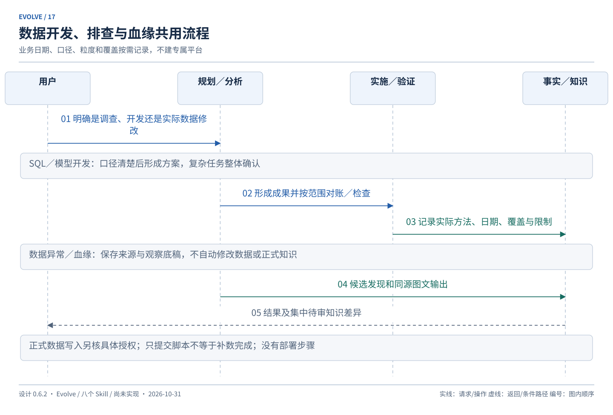

# 场景演练

设计基线：**0.6.2**；更新：2026-10-31。以下是设计预期，示例编号、指令、输出和测试均未实际执行。行为规则以 [workflows](workflows.md)为准，记录与恢复以 [runtime](runtime.md)为准；案例不另设门禁。

## A：已有项目的小修复与首次接入

用户：“修复收藏按钮重复点击后计数加两次的问题，并测试通过。”

系统先读相关组件、接口和已有规则，发现重复点击处理局部且口径明确，建议轻量梳理和简单任务。若项目未接入，只建立记录底座与资料导航，说明记录范围；不重新访谈所有模块、不自动生成正式项目规格。

呈现短方案：“复用现有去重机制，修正重复请求处理，验证连续点击及失败重试，回归取消收藏。”保存该方案正文快照、目标、验收及用户修改授权。简单任务可继续实施，无需再等一次重复修改确认，也不强制独立 spec 文件。

完成修改后运行相关检查，失败则在原范围修正复测。若发现问题其实涉及跨端幂等和接口约定，升级复杂任务，先给 spec 与任务清单确认。

预期结果：“重复点击问题已修复；相关点击、重试与取消用例通过。新增幂等说明作为知识候选等待集中确认。”此处实现与测试事实可以封存，正式知识未批准不修改。缺测试环境则改报“实现完成，验收受阻”，不能输出上述通过结论。

新空项目要创建骨架时，init 仍只接入；明确技术选择后用普通 Change 规划、实施和验证，不设初始化开发例外。

对应 V-001／V-007／V-053／V-085／V-086／V-110。

## B：复杂功能、逐项实施与新会话

用户：“实现收藏分组和批量移动，先出完整方案。”

复用已有用户／文章／收藏词汇、接口和测试入口；对分组权限及批量失败语义定向深入，不重复梳理已可信模块。形成未来 spec，明确不涉及分享和部署，测试决定随 spec 保存。

任务示例：
1. 分组创建与查询：从存储到接口形成可独立验证行为。
2. 单项移动：依赖分组能力，验证权限、去重和不存在目标。
3. 批量移动：依赖移动规则，验证部分失败及事务边界。
4. 集成与必要回归：覆盖已有收藏和取消行为。

此时只有方案、任务和未来 AC，不改实现或当前正式规格。用户：“按这份方案全部实现并测试通过。”记录整体接受，按就绪任务连续推进，不每项询问。

任务 2 后换会话：“继续收藏分组功能。”恢复对应 Change、已接受 REV、完成定义、失败尝试和测试结果，核对现场与相关依赖；不依赖原聊天、不新建重复 Change。独立查询 resume 只展示，明确继续才调用 apply。

最终验收按 spec 的必要检查完成。正式规格具体差异在结束时集中呈现；用户确认后 sync 应用。用户暂缓知识更新则封存实现结果并显示待审差异，不假称规格已同步。

对应 V-004／V-005／V-016／V-087／V-090／V-091。

## C：异常调查、跨会话续查与明确修复

用户：“看看收藏接口为什么偶发 500，先调查。”

第一轮 analyze 保存问题、时间窗口、服务版本、日志来源和覆盖。观察 F1 是特定输入出现空值，假设 H1 是并发更新导致；没有复现或因果证据时结论为 partial，不写“已定位”。经验候选提示旧版本曾有类似问题，仅作为调查线索。

新会话先 resume 恢复同链头，再按“继续排查，补看今天的日志”建立后继 run。新输入保留今天的观察窗口，旧结果仍属于昨日，不把旧日志结论外推今天。独立补查新问题可以另开主题，同一主题不无声分叉。

发现确证后给修复方案和验证方法。用户只说“原因清楚了”时结束调查，不改代码；用户明确“按方案修复并验证”后匹配已有活动 Change 或创建修复 Change。

修复的 source_runs 引用分析，而 previous 链仍只表示分析续查。verify 失败时保留真实证据，回到原授权范围内修正。新成果通过相关检查后封存，报告来源和仍未覆盖的场景。

后续发现旧根因判断错误，追加纠正并关联 H1；恢复和当前报告同时显示纠正，旧封存结果不改写。导出原报告只调用 maintain export，不重查业务或移动分析主题头。

对应 V-048—V-052／V-056—V-061／V-084／V-085。

## D：配置调整中断，继续原任务

用户明确要求把 Evolve 检查入口改为项目实际的测试命令。init 独立 run 读取旧配置、保存候选和原字节；不改 package.json 或产品脚本，不重置业务方案。

文件已替换但数据库登记前退出。新会话 resume 原 Change 时同时展示无 CHG 的配置操作和一致性阻碍。明确恢复后，若文件仍为候选，仅补登记；若被用户又改成第三种内容，保留现场，给冲突方案，不覆盖。

恢复不运行任何测试命令。原 Change 的接受仍可用，但 checks 摘要改变使相关旧验证需要重核；用户明确继续后执行新检查。仅调整显示语言则不使全部业务证据过期。

对应 V-063／V-067／V-069—V-071／V-101。

## E：SQL／模型开发至测试通过

用户：“新增店铺日支付订单汇总，按方案实现并完成验证。”

读取已有订单、退款、时区和业务日期约定。若支付日期与退款归属未明确且影响结果，先列具体分歧，不用历史候选经验自动定口径。复杂度足够时生成 spec 与任务，包含输入／输出、粒度、去重、回补边界和验收。

整体确认后形成 SQL／模型与必要测试，验证样例、边界日期、金额精度、重复输入及对账差异；按实际影响回归关联汇总。有限日期检查不能证明全部历史已正确。

预期结果明确：“SQL／模型与指定测试范围通过；正式环境未执行。”未包含在本轮授权中的补数不得写成完成。事实封存、知识修改集中审阅，无 release 阶段。

对应 V-072—V-074／V-077／V-080—V-081。

## F：数据下降调查与日期变化

用户：“分析昨天 GMV 下降，先不要改数据。”

保存指标定义来源、业务日期、粒度、版本／查询时点和可访问范围。对比流量、支付率、退款、去重等路径，旧经验只作假设线索。不能因为查询返回 0 就直接认定根因。

第二天“继续这个问题，看新增数据是否改变结论”，建立后继分析，使用新时点来源。缺少当前访问能力时说明只能复用历史，不将源码无改动视作数据未变化。

输出已证实观察、候选原因、覆盖限制与修复建议。用户未明确执行修改时，不做补数、修数或修改正式指标定义。

对应 V-075／V-080／V-083／V-089。

## G：字段血缘、报告与正式知识

用户：“梳理净支付金额字段的上游及下游引用，输出关系图。”

围绕字段定向深入，记录已读 SQL／模型版本、源字段、转换表达式、引用点、直接依据和推断。未读取的外部调度关系标未知，不宣称全局完整生产血缘。

先封存观察底稿，再由 maintain export 生成图文。导出失败只重导；用户改图形布局不改数据库观察；要纠正事实则新 analyze 关联原发现。

发现现有正式文档口径有误：本轮先生成具体知识差异候选，集中提示；涉及当前结论是否成立的冲突立即提出。用户确认具体修订后，由 propose／sync 对正式业务知识执行，不由 export 或 analyze 顺带覆盖。

对应 V-076／V-079／V-082／V-091。

## H：手工修改、知识拒绝和任务封存

系统实施期间，用户用另一个编辑器修正相关代码并修改部分注释。续接时比较相关摘要，将可核实差异记为外部来源；作者或原因不明时明确未知，不要求重新 init。

如果手改已满足任务目标，核查归属和相关测试后可采用结果，报告“包含外部修改”，不能冒称全部由 Evolve 实现。若影响已通过检查，则重验受影响项。没有变化的独立任务不全量失效。

任务验收完成，系统集中提出两条知识修订：一条说明实际接口行为，一条建议新增强制规则。用户接受前者、拒绝后者。各条记录具体决定，已批准内容按基线核对后应用，拒绝规则不修改；后续不以同义新提案反复询问。

如果用户全部延期，成果仍可封存，知识差异保持待审并在后续相关任务中可见。若差异涉及本次验收标准不确定，则先解决该关键问题，不能用“知识以后再审”绕过。

对应 V-092／V-093／V-097／V-100。

## I：两个任务并存与共享接口冲突

会话甲开发“收藏分组”，会话乙排查“支付金额差异”。两者共享项目知识但目标、记录、授权、失败尝试分别保存；互不相关可各自推进。

随后乙需要修改甲正在调整的公共金额格式器。写前发现同文件或接口重叠，展示甲的相关范围和当前现场。双方对受影响写入协调，不覆盖甲的候选；乙仍可继续独立调查与测试设计。

若乙依赖甲的新接口，依赖明确为“指定定义摘要的接口已实现且相关验证通过”，而不是“甲任务 done”。甲修订接口或取消后，乙重新核查；旧通过记录不能证明新接口可用。

同工作区 A/B 混合改动时，验证说明实际包含的版本。A 借助 B 未完成代码通过不能宣称独立完成；可以等待、明确联合验证依赖或提出隔离方案。工具不自动创建 worktree，也不承诺自动合并两个分支的 history.db。

对应 V-014／V-094—V-097。

## J：候选经验、复用效果与反例

首次排查发现“特定版本导入时空字符串可能造成去重异常”，保存来源、条件和原因假设为 candidate。

下次相关任务，系统展示“待确认线索”并读取当前实现核查；若条件不符，记录未采用及理由，不把它写进验收规则。实际采用后保存对应检查结果，不能因为整单通过就称该建议必然有效。

后来另一实例反驳原假设，关联反例并标 needs_review；后续不再作为可靠建议推荐。若存在已批准规则或待执行方案引用它，提示影响与复审，规则正文仍经用户确认才能修订。

评价第二次任务时记录减少了哪些重复背景问题、哪些线索错误或过时、是否避免重复失败；没有改善也保留结果，不用经验数量替代效果。

对应 V-098—V-100／V-108。

## K：授权补数、回执丢失与旧档案恢复

用户先要求给出正式环境某日补数方案。系统形成脚本，呈现连接身份、店铺与业务日期范围、预期行数／口径、幂等方式、对账和补偿安排；此时不执行。

用户明确批准该具体候选。apply 执行前核对摘要、环境、前置条件，保存 operation 和外部资源占用。外部已提交，但回执丢失，本地记录 effect_outcome=unknown，不能按 Task 未完成直接再跑。

新会话或另一任务请求相同对象写入时被相关占用阻碍，无关任务可继续。apply reconcile 查询原操作／取得可靠确证；查询失败保持 unknown。只看到部分目标数据不等于所有延迟副作用已结束。

此时若恢复旧 history.db，restore 仍保留 control/external 与恢复保护中的未决引用，在新 epoch 继续要求核实。maintain 不重做补数，恢复也不是补偿授权。

最终确证原操作成功，补记实际观察，再按范围对账；若业务验证失败，说明“操作已发生，验收失败”，提出具体修复／补偿方案。原授权未涵盖的补偿须重新确认，不能用“回滚”一词绕过。

对应 V-033／V-036／V-103—V-106。

## L：恢复包之外的现存文件

T1 包含规格 A，T2 新增了受管规则 B，用户还新建未登记文档 C。恢复 T1 前保护 T2 全部当前受管材料和已知外部未决操作。

恢复时 A 按清单恢复；B 保护并移出当前权威目录，避免它继续作为已生效规则；C 原位保留。若 T1 目标与 C 同路径，停止该覆盖并呈现冲突，不自动删除 C。

恢复只影响 Evolve 受管档案，不回退业务源码或真实数据。新会话核对现场和证据时效，不能把恢复包内旧测试作为当前源码已通过。

对应 V-013／V-034—V-035／V-105—V-106。

## M：正式文档就是本次交付物

用户要求“修正正式指标定义文档并检查引用”。这次文档是必需成果，不是 SQL 开发中顺带提出的知识改进。propose 形成具体差异与文档任务，标明负责动作为 sync；verify 可以先检查候选内容与引用，并注明 candidate。

用户批准后，sync 核对基线与候选检查，实际写入正式文档并记录产物；不要求“尚未应用的实际文档已经验收通过”。verify 再核实际字节和相关检查，必要时通过等价证明复用候选内容检查。全部完成后才 archive。

如果用户延期批准，就报告“方案与候选检查完成，正式文档未更新”，不能宣称整个修订完成。若应用后被其他工具改坏，最终检查失败仍未完成；apply 不能为方便流程抢写正式文件。初次基线和规则更新分别由 init／learn 同理承接。

对应 V-111／V-112／V-123。

## N：正常换会话、同方案修复与补测职责

功能任务完成一部分，用户说“先停这里，下个会话继续”。当前 owner 在安全点保存实际结果、剩余项、失败尝试和授权范围，完成本轮 run 的 partial 收尾，释放已结束的本地写段。任务仍未完成；新会话“继续”直接引用该结果，无需把正常暂停认成崩溃。

随后集成检查发现已标 done 的任务没有满足原 AC，需求和 REV 均未变化。完整实施测试授权仍有效，apply 引用失败证据重开相关任务并修正；不强制先改 spec。若仅环境不可用，保存实施事实并报告验收受阻。

另一次用户只要求 verify，系统发现缺少回归测试。verify 给补测方案，不自行修改测试源码；用户明确允许补测后，apply 新增必要测试，verify 再执行。原本在隔离测试环境产生临时数据无需伪装成业务文件修改，但仍受既有方法和范围约束。

对应 V-117／V-118／V-123。

## O：同一文件的批量确认与过时提案

用户一次批准同一规则文件中两项不冲突修改。系统先保存确定顺序和目标范围，前项应用后文件摘要改变，后项核对这是同批已批准应用造成的变化，且自身批准内容未变，以应用链证明继续，不再问同一确认。

如果两项语义冲突，或者中间用户手改了后项范围，只暂停冲突项并展示实际差异；已完成部分保留，不能把整批标成功。不同 owner 也不并行覆盖同一文件。

另有归档任务 A 的延期提案，建议文档写入旧接口行为。任务 B 后来确认并实现新行为，A 的候选需关联为过时／被替代，不因用户后来打开旧待审列表而把当前文档改回去。原批准不自动授予新文本，旧历史仍可查询。

对应 V-119／V-120。

## P：备份与在途写入、在线恢复

生成备份时，数据库固定在检查点 C，但用户又改了正式文档。恢复包的权威集合取 C 指向的版本，用户实际新字节作为现场保护附录保存，不能把新文件与旧库拼成“全部一致”的包。附件在复制期间变化时校验失败，不能宣称完整。

另一会话正要派发数据写入，此时请求 restore。维护屏障与派发准入在同一控制临界区竞争：尚未准入者不能继续派发；已准入且仍能发请求或写文件的本地实例必须先停止或到安全点，不能一边换库一边让旧请求继续。

已经发送、且本地发送者结束的外部 unknown 保留保护引用，恢复后仍核实；这不要求把未知伪造成成功才允许维护。宿主无法排空旧执行者时报告不支持在线恢复，不只靠新数据库里的 epoch 宣称已安全。

对应 V-113／V-114。

## Q：入口没变、实际 SQL 已变，以及取消后的部分效果

批准的入口脚本会读取另一个 SQL 文件。入口字节不变，但被读取 SQL 或连接别名映射发生变化，原授权不覆盖新执行物。系统核对候选清单及真实目标，变化后先重新给方案，不能只比较入口摘要就执行。

操作已发送后用户说“取消这个任务”。系统停止后续派发，保留已发送操作的核实与占用。命令返回 failed 但已修改部分行时，记录实际已知效果、未核范围和终止依据；cancel／failed 标签都不证明无副作用。

只有核实原操作终止及剩余范围后才能解除占用；重试或补偿根据剩余实际效果形成候选，不能重复修改已经完成的部分。

对应 V-115／V-116。

## R：索引故障、归档知识与完成截点

同类问题再次出现，经验索引失配。系统说明检索状态，先只读回查已有原文及相关历史；没有命中与没有完成检索分开，不立即要求用户从头讲背景。归档任务的验证事实、未应用差异和反例仍可找到并带各自状态，不能把延期意见当正式规则。

只有可选经验不可用时可继续当前已明确工作，并注明限制；必需业务定义仍缺失时才停相关判断或询问。明确继续后的写阶段可以更新索引，resume 本身不偷偷写。

本轮测试通过后、封存前，又有相关代码被手改。archive 重新核对实际依据，不能只看之前 saved passed。已经封存后才有新变更，历史完成截点保留；当前状态显示旧证据不再适用，不把历史通过冒充现在通过。

对应 V-121／V-122／V-124／V-125。

## S：小流程先可用，而非先完成全部底层

首个切片先让用户安装整包并获得真实只读诊断；下一切片让已有项目的小修改从接入、短方案走到测试／审查和基础封存。只实现这些行为需要的记录和安全保护，不先建设所有学习、分析、并发和外部执行表面能力。

之后“异常调查到修复”和“正常换会话并复用经验”都依赖已可用的小修改闭环，彼此不构成必需阻塞。单写者正式文档修订也不等待多任务并发。每项有用户结果、独立验证及不覆盖范围；广泛迁移若只能最终集成验证，则批次只报告自身实际完成，不伪称独立完整通过。

对应 V-126；实施计划 IMP-001—IMP-014 的阶段门槛与直接依赖分别说明。

## T：测试通过，但审查发现做错需求

用户只请求 verify。测试通过，但 verify 对照短方案发现“只允许本人编辑”被实现为“任何登录用户都能编辑”；另发现一个非必需命名建议。报告分别展示规格缺陷和维护建议，前者阻碍验收，后者不冒充硬性规范；当前不修改代码或重开实施状态。

用户随后明确修复，apply 在原目标范围修改并补必要测试，verify 复查发现和回归。审查包含未提交和未跟踪的相关文件；不能只比较 HEAD 后宣称不存在改动。现场被手改时重新核相关结果。实际由同一代理审查就标自审，不虚构独立审查者；没有自动提交或部署步骤。

对应 V-127／V-128／V-118／V-122／V-123。

## U：有真实症状判据，才能判断修复是否有效

订单汇总多算一笔。analyze 固定日期、输入样例和去重口径，用已有只读查询或受控环境得到“预期 2 笔、实际 3 笔”的观察，保留独立预期来源。只调查时不改业务 SQL、测试源码或真实数据；可以保留待验证假设。

获准修改后，apply 修复并按需要增加持久回归测试，verify 使用同一有效样例得到 2 笔，再检查边界。若换日期或口径，解释可比性和方案影响，不能删去重复订单样例后报告修复。偶发异常记录执行次数、失败数和条件，单次未出现不证明根除；没有修复前观察不补造失败证据。

后来同类异常反复出现，learn 提议复用或修正现有自动对账检查，获准后才由普通修改闭环落地；不直接写 CI／hook。正式术语变更仍先形成具体差异，不能借复盘自动改规则。

对应 V-129／V-130／V-135／V-136。

## V：安装、更新和卸载不改变项目事实

用户从本地分发源安装完整包，宿主将其放入缓存，项目范围单独启用。doctor 说明 Python、包版本、公共资源和接入状态；尚未 init 不创建 history.db。原始下载副本移除、缓存路径含空格／中文后仍能定位资源；散装 Skill 和整包重复出现时指出来源，不自动删其中一份。

运行期间宿主下载新版本。正在执行的 run 使用完整固定旧版本或到安全点结束；不能把新 runtime 与旧 Skill 指令混用。无法保证旧包可用时停止受影响写入，新版本在后继 run 检查兼容、现场与授权后续接。遇到不兼容 schema 只诊断，不自动升级项目库。

用户禁用或卸载插件，先安全结束本地写入，项目文档、数据库、证据、备份和外部 unknown 保护仍保留。重装复用身份；回退旧包不等于回退数据库或真实数据。清理项目资料是另一项明确请求。此案例为设计演练，尚未执行安装、升级或卸载。

对应 V-131—V-134／V-137。

## 共同边界

- 同一已批准方案在范围不变时连续推进；新关键取舍或用户收窄指令立即影响后续动作。
- 无法运行必需测试时报告受阻；已有历史失败若影响当前验收也不能跳过。
- 报告或索引失败不重做实际业务，恢复不能补造完成和因果结论。
- 只查询不隐含登记变化；明确继续后由 owner 写事实。
- 正式知识更新、实施方案接受、正式数据授权分别表达；一次具体确认已同时明确覆盖多个目标时可以引用同一来源，不重复批准相同内容。
- 所有案例无部署和个人库步骤；旧发布案例原文在快照，不能作为当前能力。

