# 命令、授权与工作流程

设计基线：**0.6.2**；更新：2026-10-31。本文维护动作归属、用户交互和业务门禁；字段／恢复见 [runtime](runtime.md)，对象含义见 [design](design.md)。

## 唯一入口与动作归属

逻辑形式为 `/evolve <动作> [目标] [说明]`，支持明确自然语言。无动作默认只读 status；未知动作或子动作报错，不降级为自由推断或默认写操作。十四个顶层动作各有唯一 owner：

- **workflow**：status、next、resume；无动作同 status。
- **init**：init；记录接入、资料发现、工具配置。
- **propose**：propose、update、analyze。
- **apply**：apply；内部方法 implement、external execute／reconcile／record／compensate。
- **verify**：verify；run／record。
- **archive**：archive、sync。
- **learn**：learn；search／review／record／retro／promote／disable。
- **maintain**：history、maintain；doctor／export／cancel／backup／restore／recover。

上列 owner 均有 evolve- 前缀。release 退出当前动作集合，旧请求只说明范围变化，不转译成数据写入。to-spec、to-tickets、implement 是借鉴的工作组织概念，不增加第二套入口或强制外部 Issue。

默认子方法固定：apply 为 implement，verify 为 run，maintain 为只读 doctor；learn 未给子方法时只说明用法，不默认写入。archive 只封存，不隐式 sync。外部 execute／reconcile／record／compensate 必须明确方法及目标，不能从普通 apply 或配置推断。目标、任务选择与方法分别解析；无法唯一解析时不执行。

普通用户可直接说“实现并测试通过”“继续订单排查”。内部 request／run／operation／摘要由工具生成，不要求用户填写。显式 ID 优先；唯一明确目标自动定位并说明，多候选时询问，不能按最近聊天猜目标。

宿主入口不假定全局命令存在；直接 Skill 和统一入口核对相同 owner、方法、目标及授权。未实现方法返回 unavailable，不由 router 代执行。宿主实测见 [delivery](delivery.md#evaluation)。

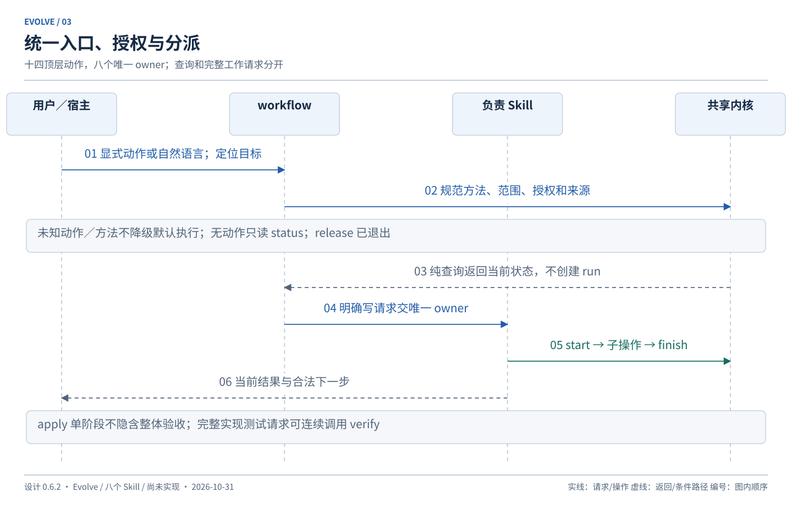

## 授权、范围和默认终点

授权先于复杂度判断。规范化后保存请求来源、允许修改的目标／范围、当前限制与已批准方案；用户后续收窄或撤销时立即约束尚未执行的动作。

1. **未明确要求执行修改**：“看看异常”“分析怎么优化”“给个方案”等先调查并呈现方案，等待修改确认。方案写出来不等于获准实施。
2. **已明确要求修改的简单任务**：先说明并保存简短方案，再推进原范围实施；不重复索要同一修改授权。
3. **复杂任务**：形成 spec 和任务清单，整体确认后按依赖推进。关键方案、目标行为、数据范围或验收含义变化需重新确认。
4. **正式知识**：遵守[集中审阅](#knowledge-approval)，不能借实施、初始化、归档或学习隐含生效。
5. **正式环境数据操作**：遵守[具体操作授权](#external-operations)，普通“修复”不等于允许修改正式数据。

自然语言“实现／修复并完成”默认覆盖当前范围内实施、必要测试与回归、失败后修正复测、事实留档及结果汇报；不包含部署、正式知识批准或正式数据写入。显式只请求 propose、analyze、apply 或 verify 时不扩张阶段：apply 可做任务级检查，整体验收仍由 verify；只 verify 不自动修复。

已有授权可持久化供续接核对，不因换会话失效；但 resume 和旧记录本身不能授权新动作。范围和现场仍适用时按“继续”复用原授权；发生关键变化则暂停受影响部分。纯查询不执行历史命令。

业务只读分析允许写 Evolve 工作事实与必要证据；即时不留档问答不建 run 或库。测试／脚本可能有副作用，先核对实际环境和行为，不能因名为 test 就默认只读。

默认完成报告包含：实际完成内容、检查与适用代码审查的覆盖及结果、未解决发现／受阻项、待确认知识差异和必要下一步。没有条件运行必需检查时，可以说明实现完成，但不能声称测试通过；必需审查缺口未闭合也不能宣称整体验收通过。

明确要求交付的正式文档、规则或知识整理结果属于本次必需成果；不能作为普通“待审知识”延期后仍宣称整个任务完成。随开发额外发现的知识改进才可单列跟进。呈现已知缺口即可，不把内部每次查询或经验命中都变成用户确认步骤。

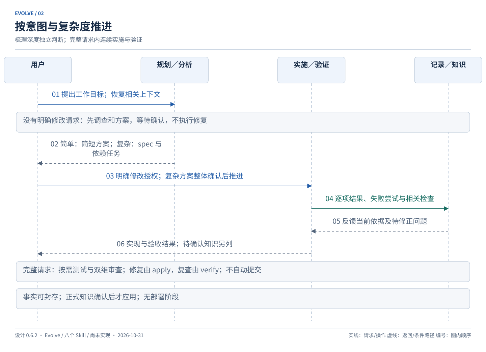

## 上下文恢复与自适应梳理

每次新任务或续接先查当前适用的项目规则、相关知识索引、任务记录和少量经验，再读取所需源码／资料核对。正式规则不可被普通经验排名或条数限制隐藏，普通上下文不全量灌入。

选择轻量、定向深入或全局梳理，说明选择理由、范围、关键未知和停止条件；不要求用户每次填写选项。资料成熟可以直接复用；资料缺失、跨模块改动或口径冲突时深入相应范围。明显扩大工作范围或引入重大选择时再确认。

实施前应能明确目标行为、业务约束、主要修改点与影响、验证方式和仍可能改变方案的未知。分析应能明确问题、观察范围、来源、结论强度和未覆盖部分。全局梳理也不要求逐行读完项目。

梳理深度不是简单／复杂任务的别名，也不是 init profile。新增观察可以保存为事实或候选；正式基线仍待具体确认。已确认且当前仍有效的信息不重复询问。

检索无命中、资料未覆盖、索引失配和来源不可访问是不同结果。必需上下文不能因索引故障而视为不存在：先只读核对已知原文及相关已封存结果，仍缺关键依据才询问或暂停。相关已验证实现、延期知识差异和后续反例即使来自已归档任务也必须可发现，但分别作为现场事实、待审意见和限制，不能冒充正式规则。具体读取顺序见 [上下文契约](runtime.md#documents)。

## workflow：任务定位与续接

status／next／resume 全程只读，不重配、索引、建库、登记外部修改、更新 guard 或接管旧 run。展示多个 Change 和分析主题，分别保留进度、未决问题、当前方案及相关阻碍。

resume 同时检查目标任务与项目级未结束配置／恢复操作，不因无 CHG 漏掉全局阻碍；展示历史快照、相关现场变化及外部资料时效限制。未读取当前外部数据时不能宣称数据未变。

目标唯一且用户明确继续时可调用负责 Skill 建新 run；单独 resume 只恢复并建议。started run 先核实原拥有者，不能因锁已消失就认为可接管。中断恢复见 [runtime](runtime.md#recovery)。

正常暂停、等待确认或结束本轮对话时，由当前 owner 保存已做／未做、下一步和授权范围，在可中断的安全点封存本轮 run；可 completed 加 partial／等待原因，不将未完成任务标 done。下一会话直接沿来源新建 run，无需先宣告异常或手动 recover。只有异常退出、未封存或未决操作才走恢复；外部 running／unknown 即使本轮结束仍保留占用。

## init：接入、发现与工具配置

先识别项目根、已有配置／库、资料及规则；身份冲突或损坏只诊断，不覆盖重建。已有资料映射沿用，不能创建第二份当前权威。

init 采用一个增量接入流程，按当前任务记录已发现资料、检查入口、候选基线和剩余缺口。0.6.0 的 records_only／development 划分已无独立业务行为，本版撤去该 profile 输入与双分支；不设置一项全局“开发已就绪”状态。只分析时接必要记录，开发时补实际所需内容，重复接入复用原库和身份。

导航中的路径、版本和来源观察可以留档；新正式项目知识先呈现差异，确认后由 init 应用初次基线。已有业务定义／规格修改归 propose → sync；经验规则归 learn。**新应用骨架使用普通 Change → apply → verify**，不再由 init 特设初始化任务自行开发。

工具配置由 init 自动生成或受控修改，固定选择不重复问，未知技术或业务决策不能填示例冒充事实。普通自然语言工作请求可在已授权接入范围调用 init；仅查询不自动接入。工具配置调整独立 run，完成后原任务重新读取，不再保留发布阶段的配置支持例外。

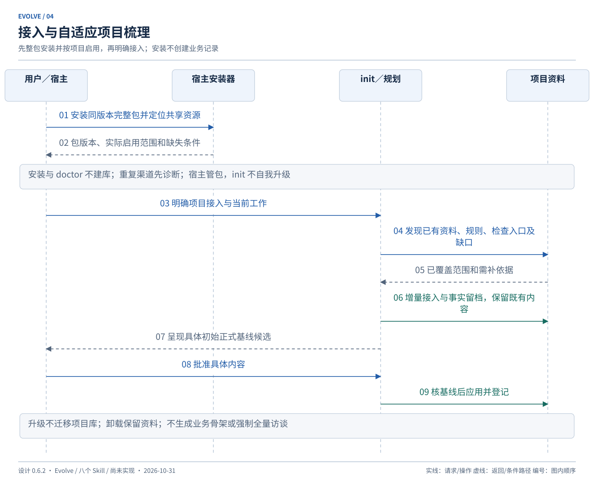

## propose／update：方案、规格与任务

先复用相关上下文并核对修改意图。仅请求方案可以生成候选 Change／REV，但不修改业务实现或正式项目知识；单纯调查无需创建 Change。

**简单路径**：保存目标、范围、做法、完成标准、检查方式、关键约束和授权来源。方案可在对话呈现，原文快照进入 artifact／REV；独立 proposal.md、spec.md、tasks.md 按需生成，至少有可追溯工作单元。

**复杂路径**：spec 包含问题、目标／非目标、目标行为、业务约束、关键取舍、测试决定和开放问题；任务清单包含可验证交付、关联 AC、前置依赖及所需上下文引用。优先纵向可验证拆分；广泛迁移可分兼容扩展、迁移、清理及最终集成验收。不要为每个微小编辑建任务。

一个实施任务优先交付一条窄而完整的用户流程，包含该流程真正需要的存储、接口、交互、检查和结果；不能只因技术分层而先建设全部表、全部 API 或全部模板。任务说明至少给出用户可见结果、独立演示／验证方法、真实阻塞条件、来源引用及不覆盖的范围，大小以能够在一次聚焦工作中理解和验证为准，不硬按代码行数或聊天窗口分割。

任务依赖只表达所需产物、行为或验证条件。共同使用内核、同属一个里程碑、写在清单前面都不是阻塞理由。就绪任务可依序选择，无需引入并行代理；同一已批准方案内不逐任务重复确认。必要预重构要有保持原行为的可验证结果；广泛迁移若无法逐批独立通过，应明确共享集成边界，最终集成通过前不得宣称各批交付了独立完整能力。

测试决定写清从哪个对外接口观察什么行为、预期结果来源、必要回归及未覆盖部分；与方案一并确认，不为每个测试重复审批。优先复用已有测试入口，缺陷适合时先建立失败判据再修正，新增功能按行为逐个实现与检查；不强制所有文案／知识任务采用 TDD。

呈现具体 spec 和任务清单后记录整体接受。apply 表示接受已经呈现、无关键未决的当前方案；未呈现的新重大方案不得沿用旧接受。明确先前批准覆盖同一内容则不重复询问。

update 生成新 REV，比较任务定义、AC、依赖和成果影响。未改变的定义可沿用适用结果；受影响已完成任务重开为 todo 并记录原因，旧完成保留。只做展示格式修订不重开任务；变更行为或检查依据重新核查证据。缩减范围需明确接受并交代被移出的工作／AC，取消任务不能直接豁免原目标。

简单任务发现新复杂度时先说明，升级 spec／任务清单并确认。关键未知只暂停受影响工作，独立已授权任务可继续。

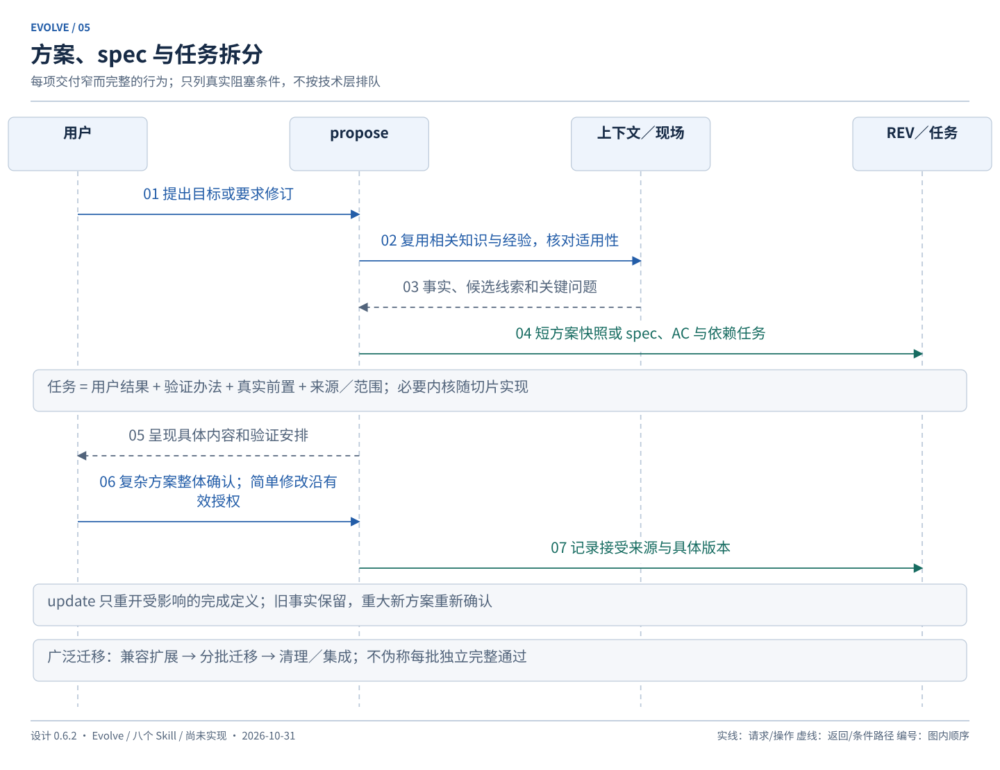

## apply：实施与任务推进

前置：目标明确、当前方案已呈现并被接受或满足简单任务的已有明确修改授权、依赖条件成立、现场与授权仍匹配、无相关未决写冲突。

默认推进目标 Change 的全部就绪任务，可指定子集。开始写入前核对相关文件、共享接口和数据范围，取得受影响资源的协调权；不能长时间持有 SQLite 事务。任务内排查沿父 run，范围变化交 propose 更新。

完成任务需保存成果、实际范围、必要检查及定义摘要，不凭文件存在标 done。普通检查失败在当前授权范围内修正复测；若需改变目标、缩小验收或引入新重大决定，先呈现方案。重复无进展时给出已尝试路径和阻碍，不无限循环或删测试换通过。

独立 verify 失败返回具体缺口，是否继续修正依据当前修改授权；仅 verify 请求不得静默转写。其他工具已经实施的成果可核对、归属、验证，但记录真实来源，不冒充本工具执行。

相同 REV 下的集成检查失败也能重开受影响任务：有修改授权时 apply 引用失败证据将 done 转 todo，随后修复并复测，不为修正实现缺陷强造新需求 REV。只有检查环境受阻时保持实施完成事实并标验收受阻；需求或 AC 改变才 update。仅 verify 请求只记录失败和建议，不重开实施状态或修改测试源码。

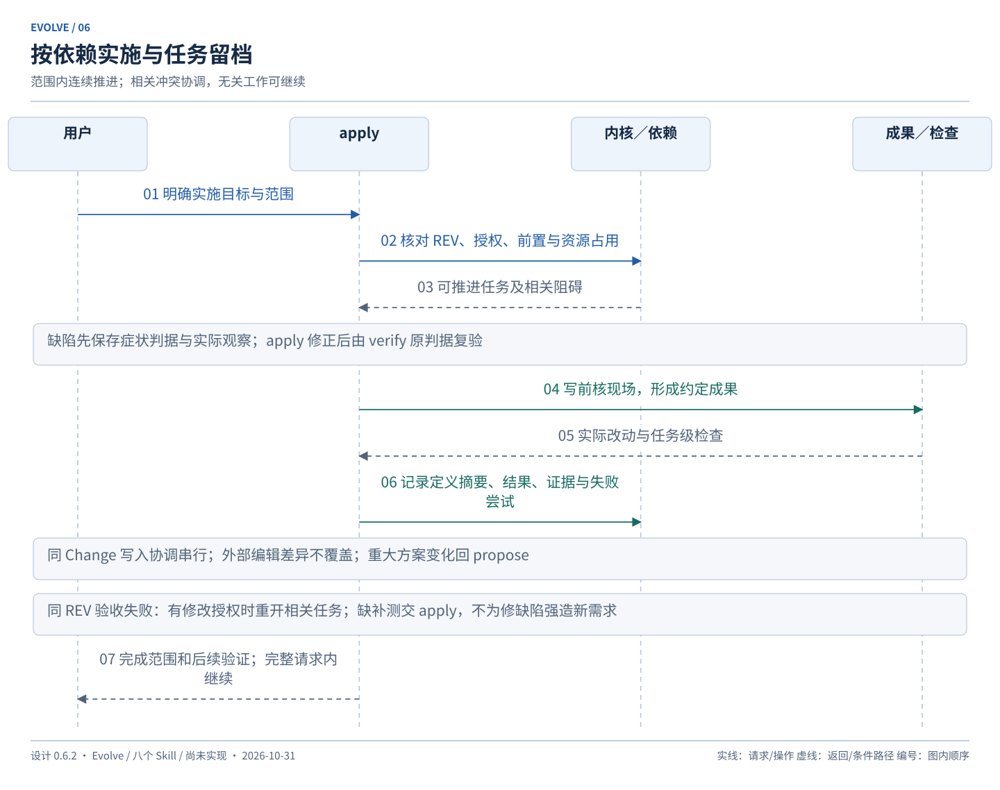

## verify：按影响验证

方案阶段明确所需检查、必要回归及扩大范围的条件；实施后基于实际改动重新核对。优先相关测试、边界行为和历史回归，复杂或广泛变更扩大范围。项目明确要求全套检查时遵守项目要求；用户选择按影响验证不等于跳过必需规范。

缺少必要测试、测试脚本或持久化夹具时，由 apply 在已有修改授权范围内补充；verify 负责指出缺口、运行检查和记录证据，不自行改测试源码、业务配置或产品实现。只请求 verify 时给出补测方案等待修改授权；已明确“实现并测试通过”时可返回 apply 后继续，不重复确认。检查方法本来允许的隔离临时输出／测试数据可以产生并如实记载。避免只镜像实现的断言；SQL／数据任务按口径、日期、粒度、去重、对账及边界验收，提交 SQL 成功不等于通过。

结果为 passed／failed／blocked／not_run，并记录成果、实际环境、方法、范围和证据。历史失败、本次引入失败、无法运行分别说明；历史失败若影响本次必需验收仍不能通过。不能把未运行包装为“不适用”；不适用需具体理由。

混合工作区必须说明关联改动和检查现场。A 依赖 B 的未完成内容时，A 不得声称独立通过；可以明确形成有依赖的联合验证证据，或协调隔离／重验，但不建立发布候选组合系统。

通过要求有效范围内所有必需 AC 均有当前适用证据。源码、依赖、验收含义或检查配置变更使相关证据重核；展示调整和无关任务事件不一律使全部过期。具体摘要见 [runtime](runtime.md#fingerprints)。

正式知识候选也可由 verify 检查内容一致性、链接和规则可执行性，但必须标明受检对象为候选；其通过不能证明目标文件已经更新。正式应用后的验证检查实际目标字节及适用检查，复用内容等价的候选证据时要记录等价证明，而非再运行全部无关检查。

### 代码审查属于 verify

实现验收同时考虑可执行检查和按影响开展的代码审查，分别呈现“规格符合性”和“项目规范／职责与维护性”。前者检查遗漏、错误行为及越出已接受范围的实现；后者检查已有规范、职责混杂、重复和没有实际需求的抽象。小改动可给简短结论，复杂跨模块改动展开相关证据；自动工具已经充分检查的机械规则引用结果即可。纯文档任务使用适用的内容检查，不虚构代码审查。

审查由 verify 组织并保存依据、范围、发现及处置，不增加 review 顶层动作或第九个 Skill，也不要求独立子代理。自审如实注明实际审查者，不称独立审查。只有短方案时以短方案和 AC 为依据，不能因为没有长 spec 跳过规格核对。

对照点必须可定位并覆盖实际工作区：已提交、未提交和未跟踪的相关内容都要计入；Git merge-base／HEAD 只是辅助，不能漏掉尚未提交的成果。已有无关用户改动标明归属与限制。依据、差异或检查配置改变时，相关审查结果与测试结果一样重核。

每项发现给出实际位置／内容引用、依据、影响、严重／中等／一般等级及是否阻碍本次验收。确定违反必需 AC 或适用硬性规范的发现未解决不能通过；主观维护建议标明判断依据，可延期并说明理由，不凭风格偏好强制改架构。争议未解决且影响必需验收时保持受阻，不能仅改级别或把发现标已读来放行。

修复由 apply 在已有修改授权内完成，verify 复查对应发现和相关回归。只请求审查或 verify 时报告问题与方案，不修改代码、测试或实施状态；完整实施验收请求可在原范围内连续修复复查。正式知识发现交原 owner 提案，不由 verify 直接写规则；审查不能自动触发提交、合并、部署或多代理。

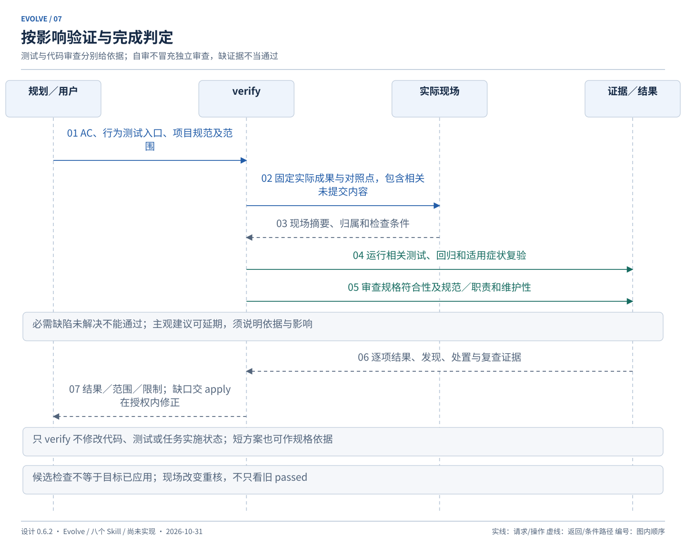

## archive／sync：成果封存与知识应用

archive 的前置是当前必需成果已经形成、任务闭合、必需验收通过、关键问题解决、结果和证据引用完整。**只有附带知识改进可以待审**；若用户要求本次修订正式文档，该文档未应用或应用后检查未通过就不能成功封存。目录移动可选，不作为完成条件。

封存结果分别展示实现／验收结论与知识待审项。待审差异持续可见；旧正式规格与现场不一致时保留冲突提醒，不能宣称“当前规格已同步”。知识问题若影响当前实现正确性或验收含义，属于关键阻碍，不能借解耦跳过。

sync 只应用已明确批准的具体业务规格／项目知识差异。业务实现的规格同步核对对应实现证据；纯文档修订则核对已批准候选及其内容检查，不要求尚未写入目标的验收先通过。初次基线由 init，经验规则由 learn，各有唯一 owner。共同审阅规则见下一节。

纯正式知识任务的完整路径为 propose／候选整理 → 具体内容确认与候选检查 → init／sync／learn 对应 owner 应用 → verify 核对实际目标 → archive（存在 Change 时）。不强加一次 apply 来抢写正式文件。任务记录注明负责动作，应用 owner 可登记对应文档任务的实际产物，最终验收仍由 verify 提供；候选检查、批准、应用、实际验收相互独立。

封存前按 [证据时效契约](runtime.md#fingerprints)重新核对相关现场和最新检查，不仅读取数据库里的 passed。封存保存被验证的具体版本及完成截点；之后的外部变化不会改写历史，但当前查询不得继续将旧通过显示成当前通过。

已归档 Change 可以追加已批准知识应用、注记或冻结成果的复验，不重开实施范围、不改写旧结果。后续实现改变建立关联新 Change。实现未完成而停止用 cancel，已做事实保留，不自动回退。

部分 sync 仅服务真实长期任务需要：所选差异须有独立批准、与交付类型相符的应用前证据及闭合依赖；纯知识修订使用候选检查，应用后再核实际目标，不要求提前取得 applied 验收。不得把剩余未批准项一起应用。同步后修订生成后继 delta，不重放旧 ADD。

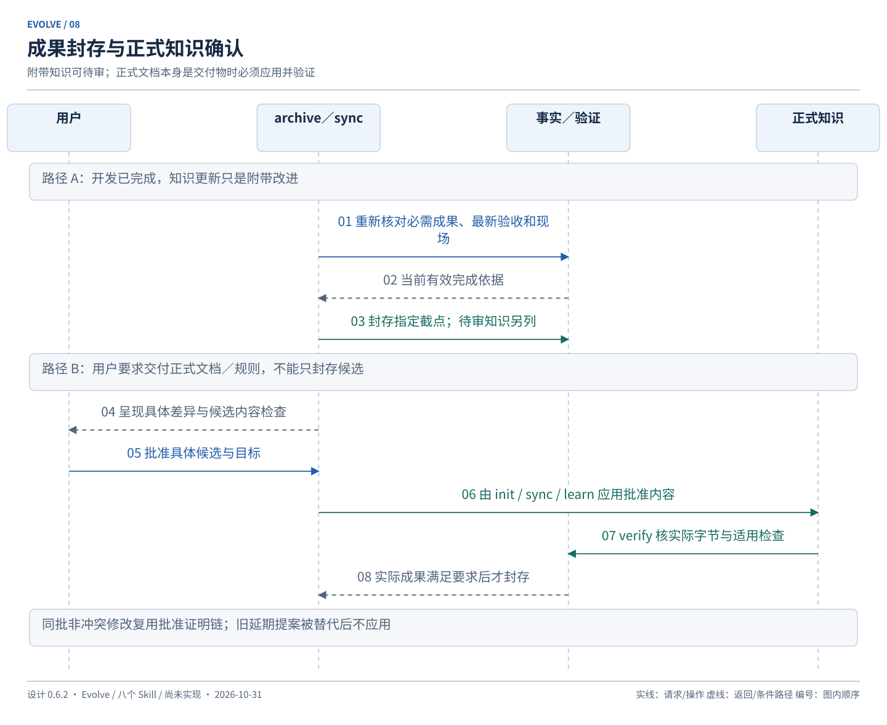

## 正式知识集中审阅

首次建立或修改正式项目知识时，先形成候选差异，展示目标文件／条目、旧新内容、原因、来源、适用范围及影响。批次可包含多个 owner 的提案，批准可以逐项接受、拒绝或延期；批次只组织展示，不是跨文件原子批准／提交。

不影响当前任务的提案在本轮结束集中呈现；同主题同目标归并证据，不反复弹同一待决项。影响当前业务方向或验收的冲突立即提出。实现事实和测试结果可先封存，知识候选延期不会抹去已完成事实。

确认绑定具体内容摘要、目标基线、范围和确认来源。批准不是已落盘；实际应用单独记录。目标或候选实质改变时旧批准不适用，显示差异再确认。用户明确批准整体修订时，原范围内各文档应用无需逐文件重复询问。

同一批次修改同一文件时，先检查目标范围、依赖和冲突，形成确定的应用顺序。前项已批准应用引起基线变化，且可证明后项的批准内容／语义范围未变时，保存应用链证明并继续，不要求用户重复批准同一内容；无法证明或有外部变化时停止相关项。不同 owner 仍共用文件协调，不对同一文件并行覆盖。

延期或已批准未应用的旧提案被后续修订取代时，保存原版本与决定，标注 superseded 或需复审并关联新提案，不按旧提案把后续有效内容改回去。用户确认新内容不等于重新确认被替代内容，已归档任务的待审项仍可被查询和处理。

拒绝和延期保留来由，下一次检索可见限制；不能通过新建同义提案绕过拒绝。当前规则被反例挑战时先标注争议并影响使用判断；learn 不自动改正式规则正文。

## analyze：独立调查、解释与血缘

输入至少包含问题、对象／范围、资料来源和期望回答。读取业务资料，保存观察、假设、排除路径、证据和剩余问题；新鲜度不能从本地未变化推断。独立调查可留档结束，不要求 CHG、TASK、VER、sync 或 archive。

在授权的隔离环境进行复现实验，并记录其副作用；不改业务源码、配置、真实数据、正式知识或运行服务。需要修复、补数或正式文档修订时提出方案，等待明确修改授权。

run 的 completed 表示本轮结束，answer_status 为 answered／partial／inconclusive；回答定位问题需足够因果依据，不能因为暂无反例就认定根因。报告／图从封存底稿导出，重导不重新分析；观察纠正用后继 analyze 并关联原发现。

### 可重复排错判据

排错先尝试建立能暴露用户具体症状的观察办法：已有失败测试、受控请求、固定输入的命令、数据对账或隔离重放。记录对象／环境、输入与版本、执行步骤、预期结果的独立来源、实际输出、观察时间及副作用；“命令成功退出”或“没有报错”不能替代异常判据。尽量固定影响结果的日期、随机种子、配置和数据范围，记录必要脱敏证据。

调查阶段可在已允许的隔离环境使用临时复现材料；新增持久化测试、业务配置、真实环境探针或服务修改须有相应修改授权，由 apply 负责。analyze 不能为得到复现而扩大授权；缺少访问条件就说明所需依据和具体方案。没有复现仍可保存假设、历史因果证据和下一步，但不得将猜测宣布为已确认根因。

修复后由 verify 使用同一有效症状判据复验并做必要回归，保留修复前后的真实结果。判据或输入必须变化时先说明其原因、可比性及验收影响，必要时重新确认；不得通过降低预期、删除失败条件或换成无关样例取得通过。没有修复前观察就如实标缺，不补造 red 记录；可采纳有来源的历史证据，不能声称亲自复现。

偶发异常保留触发条件、次数、失败数、时间范围和运行限制；修复后一次未复现不证明消除。方案中按实际风险约定可接受的复验方法，缺乏充分证据时结论保持受限或验收受阻。不机械要求所有调查都有确定性重放，也不对仅解释／血缘整理强造失败测试。持久化复用既有 run／Evidence／Verification，见 [检查记录](runtime.md#check-records)。

新会话 resume 恢复原主题和每轮资料时点；明确续查建立同链后继，另一个问题另开主题。一个主题不无声分叉；不同分析主题可并存。标题检索先折叠同链，显式历史 RUN 展示当时快照和后续纠正。

转修复先查匹配的活动 Change：已有明确匹配则 update，明确新工作则 propose，含糊时定位。来源分析不等于接受修复方案，也不等于新成果已验证。只要没有明确执行修改的请求，就止于调查及方案。

即时解释后要求留档，按实际记录时间导入并核实或标明限制；要求后续不留档不删历史。明确禁止继续写入时不偷偷 finish，之后获准再恢复；主动结束且允许记录时封存实际范围，不虚构 Change cancel。

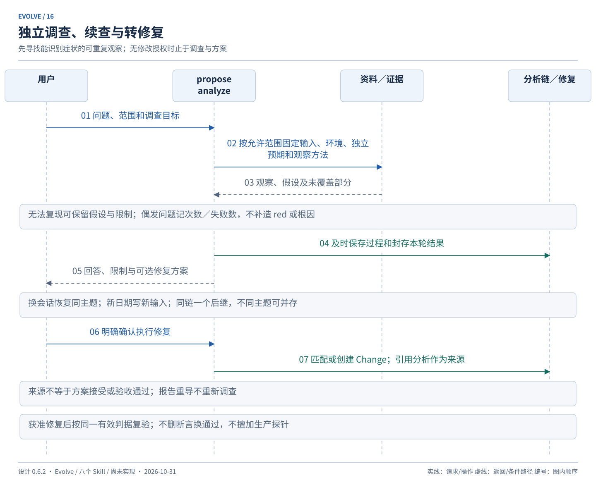

## 多任务与外部变化

共享项目知识，分别保存 Change／分析链的目标、进度、失败尝试和授权。相同工作不能因换会话重复创建；无法确认是否同一任务时先定位。

开始、恢复及写入前检查相关现场变化。可核实变化由当前写阶段登记为外部观察；纯 resume 只展示。实际修改者未知就标未知，不猜业务意图；不要求先独立 init 才允许继续普通任务。

冲突识别包括文件重叠、共享接口／结构、业务口径和明确依赖。独立任务可推进；重叠的工具写入协调串行，发现第三方编辑保留双方资料，不最后写入覆盖。检查不承诺捕捉所有隐藏语义冲突。

跨任务依赖只记录真实前置：上游目标与版本、需要的条件、核实依据及失效影响。上游 done 不等于接口通过验证；上游取消、替代或改变时重核直接受影响项。维护型“相关”关系不自动成为阻塞依赖。

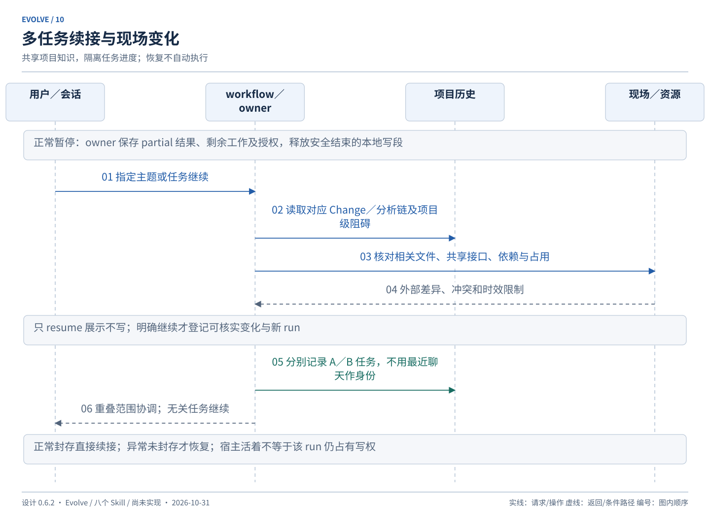

## 正式环境数据修改

默认只读分析、形成脚本并在指定测试环境验证。实际正式环境写入前，由 apply 呈现环境身份、对象／数据范围、具体脚本和参数、预期影响、验证方法及回退／补偿；不可回退的部分明确说明。

用户批准该具体候选后，核对执行时对象和前置条件，再登记操作、取得资源占用并执行。配置存在、凭证可用、历史批准或“修复问题”均不能代替本次具体授权；脚本或范围实质变化需重新确认。

实际执行物包含间接读取的 SQL／脚本、影响行为的参数和连接目标解析结果；只批准入口文件名不覆盖其后被替换的内容。无法固定或核实实际写入范围时仅给方案，不能按“已配置”默认放行。具体执行物绑定见 [外部协议](runtime.md#external-effects)。

执行信号与业务效果分别记录；超时、断连或回执损坏先核实，不通过换 operation ID 重发。无法核实保持 unknown 并阻止相关目标重写。核实操作只观察，不借机继续执行。补偿有自己的具体候选和授权，可在原批准方案已明确覆盖时复用，不因“可回退”自动执行。

本地恢复只补确定性登记，业务核实由 apply 执行；过程与字段见 [外部操作协议](runtime.md#external-effects)。

旧 release 路径已退出当前范围；此锚点只为历史引用保留。正式数据操作按上节处理，不重新引入发布或部署状态。

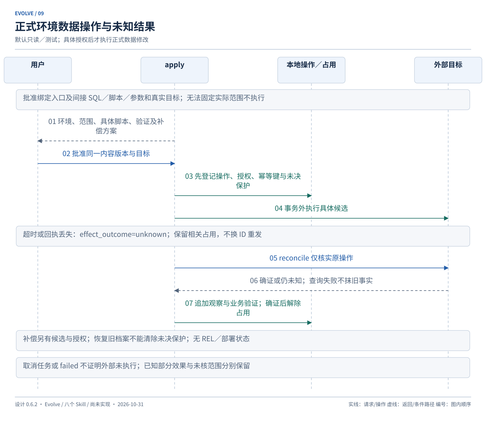

## learn：项目内经验循环

开始任务先查当前规则和正式知识，再检索少量相关经验，保留版本、来源和适用理由。未确认经验作为待核实线索展示，不能定义验收、覆盖现行规则或授权修改。

结束时自动记录有意义的失败、发现、采用与结果；没有新发现只在 run 标 no_new_learning，不强制生成复盘。尚未检查为 pending，能力未实现为 unavailable，不能混淆。

经验状态 candidate／active／needs_review／retired 表示建议的证据和适用状态，不表示用户批准。active 需清楚范围和有效支持证据；尚未确认的业务假设继续 candidate。候选经验即使被反复引用也不自动升级。

反馈区分检索命中、实际采用、对应结果及效果未知；整单通过不能归功于全部引用。反例关联原经验、受影响提案／规则和待执行方案，重核适用性；needs_review 默认不作为可靠建议，只在调查或复审中带警示展示。停用保留历史。

规则晋升给出具体文本、支持与反对证据、范围和验证方式，按集中审阅确认后应用；修改产品或增加检查工具仍走普通 Change。只做项目内学习，不访问个人经验库、不自改 Skill 本体。检索与效果验证见 [runtime](runtime.md#knowledge)和 [delivery](delivery.md#evaluation)。

反复出现且可机械判断的问题，优先提出复用／修复现有检查或新增小型 lint、测试、检查脚本的方案；主观判断才作为规则建议。learn 只形成提案和来源，获准后由 propose／apply／verify 的普通修改闭环落地，不自动安装 hook、改 CI 或扩张授权。没有可证明收益时不堆积提示词与检查设施。

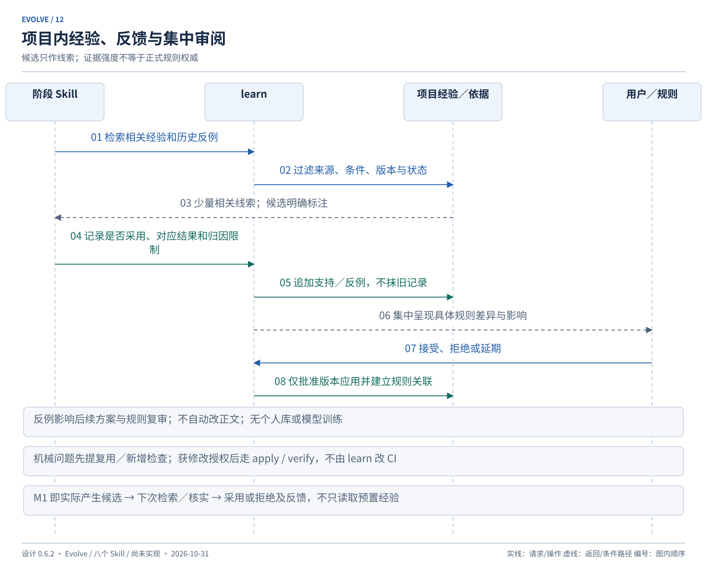

## maintain：档案维护

history／doctor 默认只读。export 从已保存事实生成报告或恢复包，二者能力明确；报告生成失败不否认源结果已提交，重导不重跑业务。cancel 记录已做、剩余和原因，不回退源码。

cancel 或撤销授权阻止尚未发出的动作，不证明已发出的外部操作停止，也不自动释放其占用。已发出操作继续保留核实任务；只有具备具体取消／补偿方法与相应授权才向外部请求停止，最后仍须核实实际效果。

backup／restore／recover 有明确目标和引用检查。档案 restore 只恢复 Evolve 受管资料，不恢复源码、正式数据或外部环境；不能清除未知外部操作来获得重发许可。未登记用户文件保留，包外受管文件按清单保护和隔离。细则见 [runtime](runtime.md#recovery)。

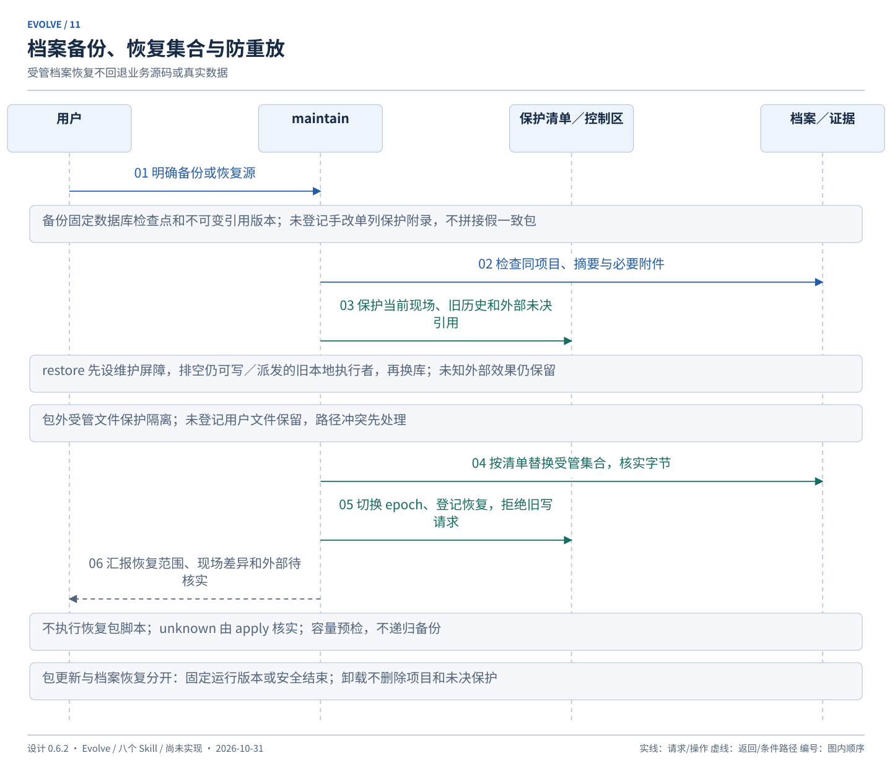

## 状态及完成含义

Change：draft → ready → active → archived；非终态可 blocked，恢复回原阶段；未归档可 cancelled。ready 不等于接受；验收通过、知识待审、可封存由事实派生，不另设手工完成状态。

Task：todo → in_progress → done；可 blocked／cancelled。修订影响定义，或同一有效定义被后续失败证据证明未满足时，可由实施负责者在有效修改授权下转 todo，保留原结果和重开理由；仅环境问题不抹去实施事实。重开已归档／取消实现范围使用关联新 Change，不改原终态。

Verification：not_run／passed／failed／blocked，时效 current／stale／unconfirmed 由来源核对决定；未核查不能称 current。知识 approved 与 applied 分开。run completed 仅表示本次职责结束；external unknown 独立于 run 是否结束。

轻量任务与复杂任务共用上述事实模型，差异在材料、拆分和确认，不再为简单修改机械生成空文档。

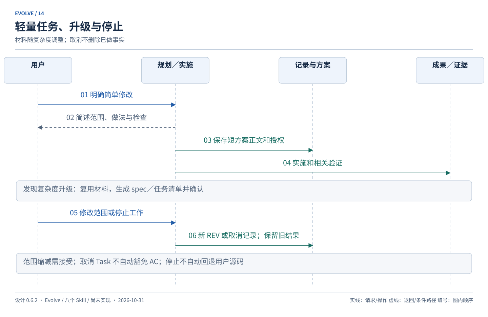

